# The CueDex guide

This guide describes CueDex as it is in the current build, for VJs, show operators and AV technicians. Start with the
[TL;DR](index.md) if you want the short version.

In this guide, a label you see on screen (a button, a menu item, a tab or a setting) is written in bold, exactly as
the app shows it. Keys look like <kbd>Space</kbd>.

<details markdown="1">
<summary><b>Contents</b></summary>

1. [What CueDex does](#what-cuedex-does)
2. [Install and first launch](#install-and-first-launch)
3. [Concepts](#concepts)
4. [A tour of the window](#a-tour-of-the-window)
5. [Building a set](#building-a-set)
6. [The timeline](#the-timeline)
7. [Cues and target profiles](#cues-and-target-profiles)
8. [Outputs](#outputs)
9. [GO and the audio buffer](#go-and-the-audio-buffer)
10. [Following music by ear: the listener](#following-music-by-ear-the-listener)
11. [External players: Spotify, Music, TIDAL](#external-players-spotify-music-tidal)
12. [Layers and shared cues](#layers-and-shared-cues)
13. [The Show window and the web remote](#the-show-window-and-the-web-remote)
14. [Pre-show check](#pre-show-check)
15. [The status bar and the Debug panel](#the-status-bar-and-the-debug-panel)
16. [Preferences](#preferences)
17. [Keyboard shortcuts](#keyboard-shortcuts)
18. [Troubleshooting](#troubleshooting)
19. [Measured performance](#measured-performance)
20. [Privacy](#privacy)
21. [Licences and third-party notices](#licences-and-third-party-notices)
22. [FAQ](#faq)
23. [Glossary](#glossary)
24. [For developers](#for-developers)

</details>

## What CueDex does

CueDex is a timeline that runs on music. A show is a list of tracks (a set). Each track has a timeline of cues on
lanes. While a track plays, CueDex:

- sends **timecode** that follows the music to the frame: LTC (audio), MTC (MIDI) and ArtTimeCode (Art-Net);
- sends **cues** at the exact moment the music reaches them: OSC messages (Resolume Arena, QLab, grandMA3, ChamSys
  MagicQ, Bitfocus Companion and any OSC receiver), MIDI notes / CC / program changes / ramps, MIDI Show Control and
  MIDI clock;
- can write the playhead straight into OnTheWire (OTW), a companion app on the same Mac.

The music can come from three places:

1. *CueDex's own player.* CueDex plays your files and makes the music and the LTC in the same audio callback, so
   they cannot drift apart. GO starts the music in the next audio buffer.
2. *An app CueDex drives.* CueDex tells Spotify or Music what to play and starts its timeline on the first sound it
   hears from that app. It starts, pauses and places the track TIDAL holds, and it can follow any app that shows in
   macOS Now Playing.
3. *Any player, followed by ear.* CueDex listens to the audio (the whole Mac, one app, or an input), recognises the
   track and the position and follows it, including DJ tempo changes, hot cues and loops.

Timecode, cues, MTC, Art-Net and OTW all follow one transport, whichever of the three moves it.

## Install and first launch

### Requirements

- A Mac with Apple silicon, running macOS 14.2 or later.
- For LTC to another program on the same Mac: a virtual audio device such as BlackHole. For LTC to another computer
  or a console: an audio interface output.
- Optional: Spotify (desktop app), Music, TIDAL; `yt-dlp` for links (CueDex can install it); an iPad or iPhone for
  the web remote.

### Opening the app

1. Drag `CueDex.app` to your Applications folder.
2. Open it. CueDex is signed with a Developer ID but not notarised, so macOS may refuse the first launch. In that
   case open **System Settings → Privacy & Security**, scroll to the message about CueDex and click
   *Open Anyway*. You only need to do this once.

### Permission prompts and what they are for

macOS asks for each permission the first time CueDex needs it. You can change your answer later in
*System Settings → Privacy & Security*.

| Prompt | When it appears | What CueDex does with it |
| --- | --- | --- |
| Microphone | The listener captures an input device (a line-in, an interface, BlackHole as an input) | It analyses the audio in memory to follow the music. Nothing is recorded or stored. |
| System audio recording | The listener or an external player uses a process tap (it hears what the Mac or one app plays) | The same: analysis in memory, never stored. |
| Automation (Spotify, Music, System Events) | You add or start a track in Spotify or Music | It tells the app which track to play and where, and reads its position. |
| Local network | CueDex sends OSC to another computer, or serves the web remote | It sends cues and timecode to your show computers, and serves the remote page to your iPad or iPhone. |
| Keychain | You publish cues to the shared database for the first time | It keeps your signing key in your login keychain. |

### The first launch

CueDex opens the demo set: three short synthesised tracks with every kind of cue, a beat grid and sections. Its
OSC cues go to this Mac only (port 9100), its MIDI cues go to the virtual **CueDex MIDI** source, and the lane aimed at
Resolume Arena is muted.

<div class="markdown-alert markdown-alert-important" markdown="1">
<p class="markdown-alert-title"><svg class="octicon octicon-report" viewBox="0 0 16 16" version="1.1" width="16" height="16" aria-hidden="true"><path d="M0 1.75C0 .784.784 0 1.75 0h12.5C15.216 0 16 .784 16 1.75v9.5A1.75 1.75 0 0 1 14.25 13H8.06l-2.573 2.573A1.458 1.458 0 0 1 3 14.543V13H1.75A1.75 1.75 0 0 1 0 11.25Zm1.75-.25a.25.25 0 0 0-.25.25v9.5c0 .138.112.25.25.25h2a.75.75 0 0 1 .75.75v2.19l2.72-2.72a.749.749 0 0 1 .53-.22h6.5a.25.25 0 0 0 .25-.25v-9.5a.25.25 0 0 0-.25-.25Zm7 2.25v2.5a.75.75 0 0 1-1.5 0v-2.5a.75.75 0 0 1 1.5 0ZM9 9a1 1 0 1 1-2 0 1 1 0 0 1 2 0Z"></path></svg>Important</p>

CueDex always starts with its cues off (**REHEARSE: cues off**): no OSC, MIDI or MSC cue is sent. Timecode (LTC, MTC,
Art-Net), MIDI clock and OTW direct still run, so your receivers can lock while you rehearse. Click
**REHEARSE: cues off** in the timeline toolbar (or press <kbd>⌘R</kbd>) to go **LIVE: cues on**.

</div>

You can open the demo again at any time from the **File** menu: **Open the Demo Set**.

## Concepts

| Term | What it means |
| --- | --- |
| Set | Your show: a list of tracks plus the output settings. It is saved as a `.set.json` file next to one cue file per track. |
| Track | One piece of music: an audio file CueDex plays, or an external track that Spotify, Music, TIDAL or another app plays. A set holds up to 24 tracks. |
| Hour | Each track has its own timecode hour. Track 1 runs in hour 01, track 2 in hour 02 and so on, so the hours digit tells you the track. You can change a track's hour in the Set view. |
| Lead-in | The time before the music starts when you start a track from the beginning (default 2 s). With the default, track 1's music starts at `01:00:02:00`. |
| Gapless | When a track's music ends, CueDex jumps straight to the next track's music start, with no silence. LTC jumps to the next hour, MTC sends a full-frame message, and Art-Net's hours change. |
| Lane | One row of cues for one output: an OSC target (with a profile), a MIDI destination and channel, an MSC device, or plain markers and sections. |
| Cue | One action at one position of the music: an OSC message, a profile verb ("connect clip 3 on layer 2"), a MIDI message or ramp, an MSC command, a marker or a section. A cue can be a range, with a start and an end. |
| Profile | A description of a target program: its OSC address book, its verbs and its measured delays. CueDex ships profiles for Resolume Arena, QLab 5, grandMA3, ChamSys MagicQ and Bitfocus Companion. |
| Lead and offset | Per lane: the lead is how early CueDex sends so the target reacts on time (its measured delay). The offset moves a whole lane later (+) or earlier (−). |
| Layer | One version of a track's cues: yours, one you downloaded, a merged mix, an automatic one or a frozen show copy. See [Layers](#layers-and-shared-cues). |
| Rehearse / live | Rehearse = no cue is sent (timecode still runs). Live = cues are sent. |
| GO | Start the show from where the playhead stands, as fast as possible. |
| Show mode | The engine plays each track's frozen SHOW layer and nothing else, so nothing changes during the gig. |

## A tour of the window

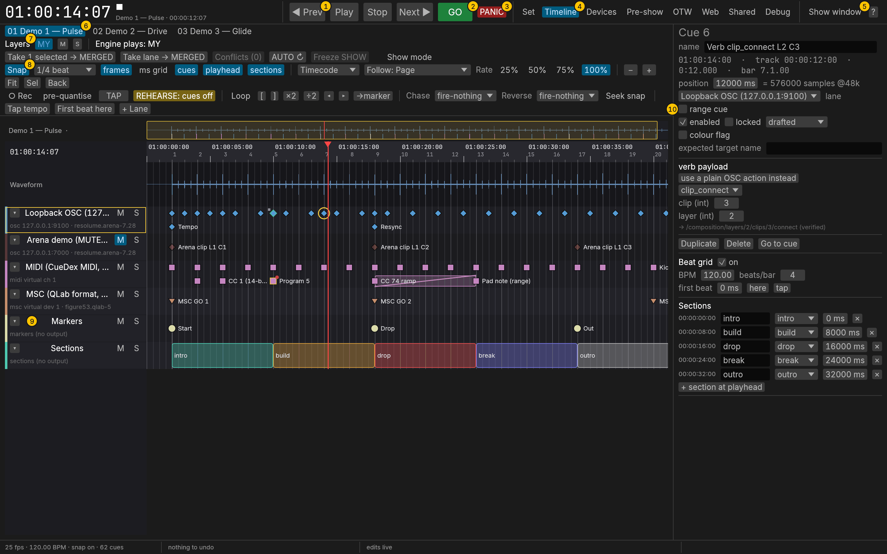

1. **◀ Prev**, **Play**, **Stop**, **Next ▶**: the transport. Left of them are the show timecode, the transport state
   and the track position.
2. **GO**: start from the playhead (see [GO](#go-and-the-audio-buffer)).
3. **PANIC**: stop the transport and switch the cues off at once (rehearse on).
4. The tabs: **Set**, **Timeline**, **Devices**, **Pre-show**, **OTW**, **Web**, **Shared**, **Debug**.
5. **Show window**: the big-screen view for the operator (see [Show window](#the-show-window-and-the-web-remote)).
6. The track chips: click one to edit that track. A dot after the name means it has unsaved changes.
7. **Layers**: the track's cue layers and what the engine plays.
8. **Snap** and the rest of the timeline toolbar.
9. The lanes: one row per output, with the waveform above them.
10. The inspector: edits what is selected (here a cue).

The light theme looks like this (**Preferences…**, then **Look**: untick **dark**). The timeline itself stays dark
in both themes:

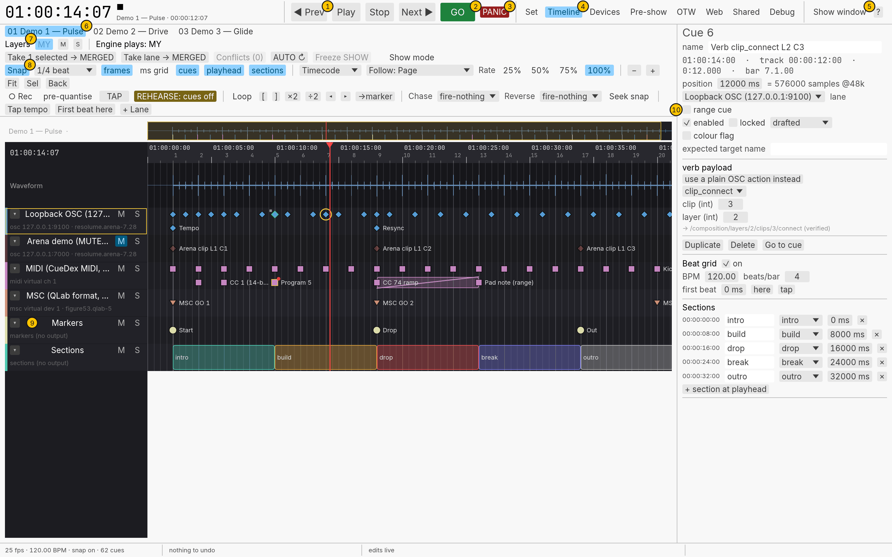

The transport bar keeps every button in place while the time runs. The time counter, the state and the track
position each have their own fixed space.

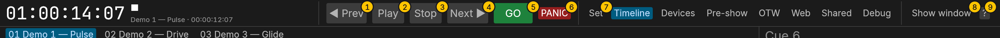

1. **◀ Prev**: the previous track.
2. **Play**: play or pause (<kbd>Space</kbd>).
3. **Stop**.
4. **Next ▶**: the next track.
5. **GO** (<kbd>G</kbd>).
6. **PANIC** (<kbd>⇧⌘.</kbd>).
7. The tabs.
8. **Show window** (<kbd>⌘5</kbd>).
9. **?**: the keyboard shortcuts.

Next to the state, **CUED** (green) means CueDex's own player has the GO position decoded and ready, so GO will start
in the next audio buffer. **cueing…** (amber) means it is still decoding.

## Building a set

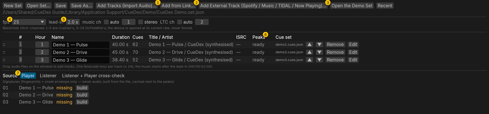

1. **Add Tracks (Import Audio)…**
2. **Add from Link…**
3. **Add External Track (Spotify / Music / TIDAL / Now Playing)…**
4. **fps**
5. **lead-in**
6. **Peaks**: the waveform's state.
7. **Source**: where the transport's position comes from.

### Start a set

- **New Set** (<kbd>⌘N</kbd>) starts an empty set. **Open Set…** (<kbd>⌘O</kbd>) opens a `.set.json` file. **Recent**
  lists the last twelve.
- **Save** (<kbd>⌘S</kbd>) and **Save As…** (<kbd>⇧⌘S</kbd>) write the set file and one cue file per track next to
  it. CueDex also autosaves unsaved changes every 60 seconds to its own folder. If an autosave is newer than the set
  when you open it, CueDex asks **Recover autosave?** with **Open the autosave** and **Ignore**.

### Add tracks

1. **Add Tracks (Import Audio)…** (<kbd>⌘I</kbd>), or drop audio files on the window. The dialog offers WAV, AIFF,
   CAF, M4A / AAC, MP3 and FLAC; other formats macOS's AudioToolbox reads can be dropped on the window. It cannot play Ogg / Opus, or `.m4p` files
   (protected by DRM). The first import of a file builds its waveform once; after that it comes from the cache.
2. **Add from Link…** (<kbd>⇧⌘L</kbd>): paste track, playlist, album or set links, one per line (YouTube, YouTube
   Music, SoundCloud, Bandcamp and the other sites `yt-dlp` supports). Click **Look up**: CueDex lists every track in
   each link without downloading anything. Then the **Fetch** button (it says how many tracks) downloads them in order into the set's `media`
   folder. They become normal file tracks that CueDex plays itself. Tracks you already fetched come from the archive.
   CueDex refuses an artist page (a list of lists): paste one of its albums.
3. **New Set from Link…** does the same into a new set: CueDex asks where the set's folder should go, writes the set
   when the first track is in, and saves it again when the list is done.
4. **Add External Track (Spotify / Music / TIDAL / Now Playing)…** (<kbd>⇧⌘E</kbd>) adds a track that another app plays.
   See [External players](#external-players-spotify-music-tidal).

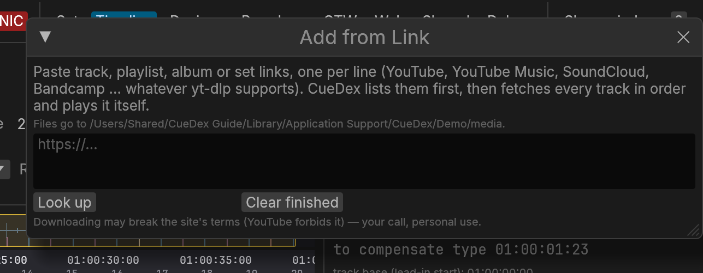

<div class="markdown-alert markdown-alert-warning" markdown="1">
<p class="markdown-alert-title"><svg class="octicon octicon-alert" viewBox="0 0 16 16" version="1.1" width="16" height="16" aria-hidden="true"><path d="M6.457 1.047c.659-1.234 2.427-1.234 3.086 0l6.082 11.378A1.75 1.75 0 0 1 14.082 15H1.918a1.75 1.75 0 0 1-1.543-2.575Zm1.763.707a.25.25 0 0 0-.44 0L1.698 13.132a.25.25 0 0 0 .22.368h12.164a.25.25 0 0 0 .22-.368Zm.53 3.996v2.5a.75.75 0 0 1-1.5 0v-2.5a.75.75 0 0 1 1.5 0ZM9 11a1 1 0 1 1-2 0 1 1 0 0 1 2 0Z"></path></svg>Warning</p>

Downloading may break a site's terms (YouTube forbids it). CueDex says so in the window; whether you download is up
to you, for personal use.

</div>

### The track table

| Column | What it shows |
| --- | --- |
| **::** | Drag handle: drag a row to reorder. **▲** and **▼** do the same one step at a time. |
| **#** | The track's position in the set. |
| **Hour** | The timecode hour (00–23). It follows the order unless you set it. |
| **Name** | The track name: click to rename. |
| **Duration** | The music's length in seconds. |
| **Cues** | The number of cues on the track. |
| **Title / Artist** | From the file's tags, or the external app. |
| **ISRC** | The recording code from the tags, if the file has one. |
| **Peaks** | The waveform: **ready**, **building…** or why it failed. |
| **Cue set** | The track's cue file (**(new on save)** until you save). |

At the end of each row: **Remove**, **Edit** (opens the track on the timeline) and, when the file has gone missing,
**MISSING FILE** with **Relink…**.

### Set settings

| Setting | What it does |
| --- | --- |
| **fps** | The timecode frame rate: 24, 25, 29.97df, 29.97ndf or 30. |
| **lead-in** | Seconds before the music when a track starts from its beginning (0–30, default 2). |
| **music ch** | The output channel for the music: **auto**, or a channel number with **stereo** for two channels. |
| **LTC ch** | The output channel for LTC: **auto** or a channel number. |

With **auto**, a 2-channel device gets music on channel 1 and LTC on channel 2, and a device with 3 or more channels
gets music on 1–2 and LTC on 3. With one music channel, a stereo file is mixed to mono. CueDex always opens a device at
the sample rate it is already running at; it never changes the rate for other apps.

<div class="markdown-alert markdown-alert-tip" markdown="1">
<p class="markdown-alert-title"><svg class="octicon octicon-light-bulb" viewBox="0 0 16 16" version="1.1" width="16" height="16" aria-hidden="true"><path d="M8 1.5c-2.363 0-4 1.69-4 3.75 0 .984.424 1.625.984 2.304l.214.253c.223.264.47.556.673.848.284.411.537.896.621 1.49a.75.75 0 0 1-1.484.211c-.04-.282-.163-.547-.37-.847a8.456 8.456 0 0 0-.542-.68c-.084-.1-.173-.205-.268-.32C3.201 7.75 2.5 6.766 2.5 5.25 2.5 2.31 4.863 0 8 0s5.5 2.31 5.5 5.25c0 1.516-.701 2.5-1.328 3.259-.095.115-.184.22-.268.319-.207.245-.383.453-.541.681-.208.3-.33.565-.37.847a.751.751 0 0 1-1.485-.212c.084-.593.337-1.078.621-1.489.203-.292.45-.584.673-.848.075-.088.147-.173.213-.253.561-.679.985-1.32.985-2.304 0-2.06-1.637-3.75-4-3.75ZM5.75 12h4.5a.75.75 0 0 1 0 1.5h-4.5a.75.75 0 0 1 0-1.5ZM6 15.25a.75.75 0 0 1 .75-.75h2.5a.75.75 0 0 1 0 1.5h-2.5a.75.75 0 0 1-.75-.75Z"></path></svg>Tip</p>

Sharing BlackHole 16ch with OnTheWire? Channels 1–2 are CueDex's and 3–16 are OnTheWire's.

</div>

### Source

At the bottom of the Set view, **Source** chooses where the transport's position comes from:

- **Player**: CueDex plays the files.
- **Listener**: CueDex follows another player by ear; its own music outputs stay silent.
- **Listener + Player cross-check**: CueDex plays the files and listens to itself (a self-test).

Below it, the **Signatures** table shows each track's fingerprint state (**built**, **building**, **missing**,
**failed**) with **build** / **rebuild**. External tracks show **learned** or **learns on its first full play**.

## The timeline

### The toolbar

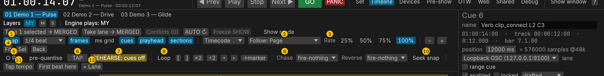

1. **Snap** (<kbd>S</kbd>) and what it snaps to: a beat division (1/1 to 1/16 beat, or **beats off**),
   **frames**, an **ms grid** with its step, **cues** (other cues' edges), **playhead** and **sections**. Hold
   <kbd>⌥</kbd> while dragging to place without snapping.
2. The ruler (**Timecode**, **Bars.Beats** or **mm:ss.ms**) and **Follow** (**Off**, **Page**, **Centre**, **Edge**).
   Scrolling while playing pauses the follow; it shows **(paused)** until the next play or GO.
3. **Rate**: the placing rate, 25 %, 50 %, 75 % or 100 % (<kbd>⌥1</kbd>–<kbd>⌥4</kbd>). Slower playback
   to place cues precisely; the pitch changes with it.
4. Zoom: **−**, **+**, **Fit**, **Sel** (to the selection), **Back**.
5. **○ Rec**: record mode (see [Tap-to-place](#tap-to-place-and-record-mode)).
6. **TAP**: place a cue at the live position. **pre-quantise** snaps taps to the snap grid (the raw tap is kept).
7. **REHEARSE: cues off** / **LIVE: cues on**.
8. **Loop** and its tools: **[** in, **]** out, **×2**, **÷2**, **◂** / **▸** nudge, **→marker**.
9. **Chase** and **Reverse**: what cues do when you jump or play backwards (below).
10. **Seek snap**: your jumps land on the timecode frame grid.
11. **Tap tempo** (<kbd>T</kbd>, tap three or more times) and **First beat here** (<kbd>B</kbd>).
12. **+ Lane**: add a lane.

**Chase** decides what happens to the cues you jump over:

- **fire-nothing**: nothing; the cues after the new position fire as the music reaches them.
- **rebuild-state**: CueDex sends the state the cues before the new position would have left (for example the clip
  that should be connected).
- **fire-skipped**: CueDex fires the cues you skipped.

**Reverse** decides what happens when the transport runs backwards: **fire-nothing** or **fire-reverse**.

### Lanes and the waveform

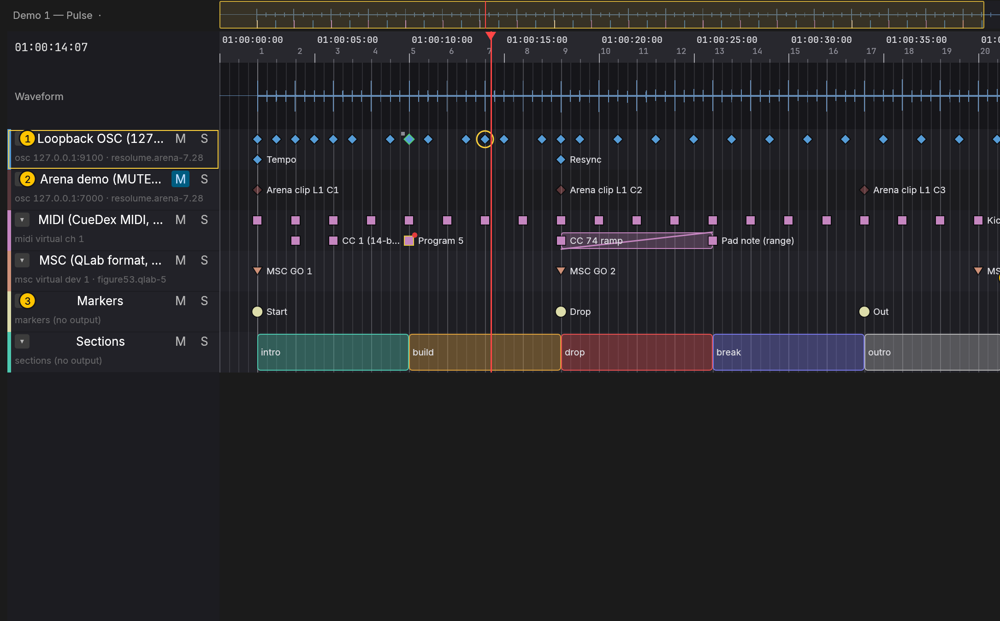

1. An OSC lane with a profile (here Resolume Arena, sending to this Mac).
2. A muted lane (the demo's Arena lane, muted so that nothing reaches Arena).
3. **Markers**: named positions you jump between with <kbd>.</kbd> and <kbd>,</kbd>.
4. **Sections**: the song's parts (intro, build, drop, break, outro).

Each lane header has **▾** / **▸** (collapse), the lane's name (click it to edit the lane in the inspector and make it
the active lane for tapping), **M** (mute: never sends) and **S** (solo). Under the name you see the target, and for
OSC, MIDI and MSC lanes the **lead** and **offset** in milliseconds, when the lane is tall enough (drag it taller, or
raise **default lane height** in the preferences). A lead of **profile** uses the profile's measured lead.

**+ Lane** offers: **OSC (loopback 127.0.0.1:9100)**, **OSC → Arena 7000 (muted)**, **MIDI (CueDex MIDI)**,
**MSC (CueDex MIDI, all-call)**, **Markers** and **Sections**. A new lane changes the outputs, so it applies at the next
stop if the transport is playing.

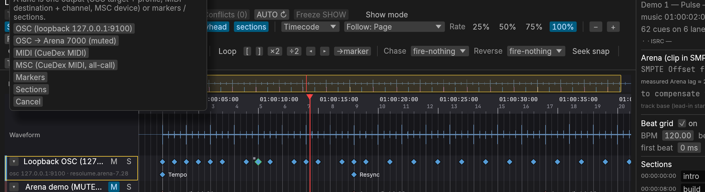

### Editing with the mouse

| Do this | To |
| --- | --- |
| Click, <kbd>⇧</kbd>-click, <kbd>⌘</kbd>-click | Select, add to the selection, toggle a cue in the selection |
| Drag a cue | Move it (with snap). Press <kbd>⌥</kbd> during the drag to move without snap. Hold <kbd>⌥</kbd> from the start of the drag to duplicate (the copies move unsnapped). |
| Drag the edge of a range cue | Resize it |
| Drag on an empty part of a lane | Rubber-band selection |
| Double-click a lane | Add a cue there |
| Click or drag in the ruler | Scrub (seek) |
| Right-drag | Zoom to a band |
| Middle-drag | Pan |
| Wheel or pinch with <kbd>⌘</kbd> / <kbd>ctrl</kbd> | Zoom |
| <kbd>⇧</kbd>-wheel or a trackpad swipe | Scroll |
| Click or drag the overview strip | Move the view |

### Editing with keys

Arrow keys nudge the selected cues by the snap unit, <kbd>⌥←</kbd> / <kbd>⌥→</kbd> by one frame,
<kbd>⌘←</kbd> / <kbd>⌘→</kbd> by 1 ms, <kbd>⌃⌘←</kbd> / <kbd>⌃⌘→</kbd> by 2 ms, <kbd>⇧⌘←</kbd> / <kbd>⇧⌘→</kbd>
by 10 ms and <kbd>⇧←</kbd> / <kbd>⇧→</kbd> by one beat. <kbd>↑</kbd> / <kbd>↓</kbd> move cues to the lane above or
below. <kbd>Tab</kbd> selects the next cue. The full list is under [Keyboard shortcuts](#keyboard-shortcuts).

Every edit can be undone (<kbd>⌘Z</kbd>, <kbd>⇧⌘Z</kbd>), and **History…** (<kbd>⌘7</kbd>) lists the edits so you can
jump back to any point. Each track has its own history.

Cue edits are live: change a cue while the music plays and the next pass of the playhead uses the new version (the
status bar shows *edits live*). Changes to outputs (a new lane, a target, the device) apply at the next stop.

### Tap-to-place and record mode

Play the music and press <kbd>Return</kbd> or <kbd>M</kbd> (or click **TAP**) on the beat: CueDex adds a cue on the
active lane at the moment of your key press. It uses the key's own time stamp from macOS, takes off the output
device's latency (about 16 ms on the built-in speakers, 0 on BlackHole) and your **reaction offset** from the
preferences. The position the tap really had is kept as the cue's raw position, so **Quantise to Snap** (<kbd>Q</kbd>)
and **Back to Raw (tap) Position** (<kbd>⇧Q</kbd>) can switch between them.

Record mode (<kbd>R</kbd> or **○ Rec**, then **● REC**): keys <kbd>1</kbd>–<kbd>9</kbd> write a cue on lane 1–9,
<kbd>Return</kbd> / <kbd>M</kbd> on the active lane, and the pads of any MIDI input write a cue on the lane of their
note number (note modulo the number of lanes). Recorded cues are marked **● recorded** until you **mark edited**.

### Loops, rates and the beat grid

- **Loop** (<kbd>L</kbd>) loops a region; without one it loops four bars from the playhead. <kbd>[</kbd> and
  <kbd>]</kbd> set the in and out points at the playhead, <kbd>⌘]</kbd> / <kbd>⌘[</kbd> double and halve, <kbd>⌥[</kbd>
  / <kbd>⌥]</kbd> nudge, <kbd>⇧L</kbd> loops to the next marker.
- The beat grid (the inspector's **Beat grid**, with **BPM**, **beats/bar** and **first beat**) gives you bars and
  beats to snap to and drives MIDI clock. **here** sets the first beat at the playhead, **tap** is tap tempo.
- **Sections** in the inspector name the song's parts; **+ section at playhead** adds one.

### The inspector

With one cue selected, the inspector shows its editor:

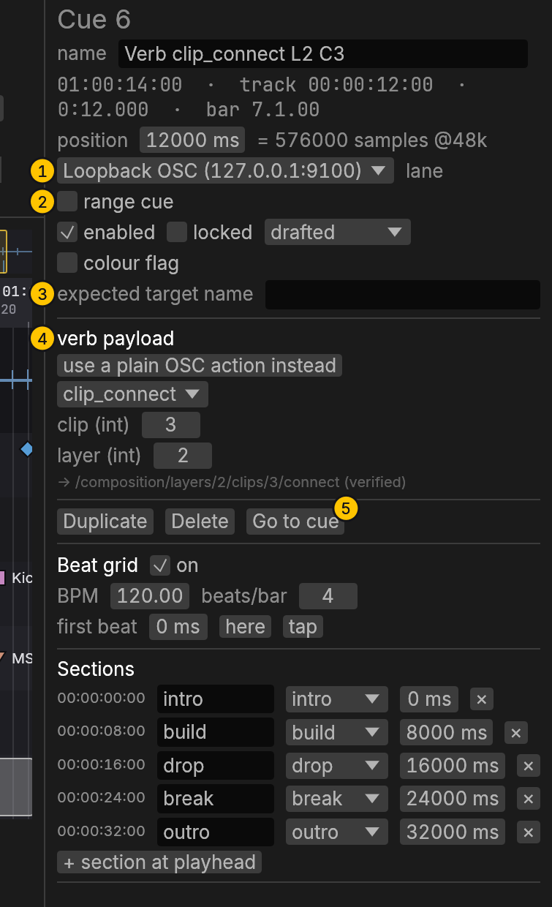

1. **lane**: move the cue to another lane of the same kind.
2. **range cue**: give the cue a length (**span**). Under **fire the payload on**, tick one or more of **entered**,
   **started-on-beat** (the default), **started-late** and **ended** (notes and ramps have these too, without a range).
3. **expected target name**: what the pre-show check expects the target to report at this cue's address.
4. The payload (here a profile verb) and its fields.
5. **Duplicate**, **Delete**, **Go to cue**.

Above them: the name, the position (timecode, track time, mm:ss and bar) with a **position** field in ms and the exact
sample, and, for a tapped cue, its raw position with **back to raw** and **forget raw**. Between the range cue and the
expected target name: **enabled**, **locked**, the state (**drafted**, **tested**, **ready**) and a **colour flag**.

With several cues selected, the inspector offers batch actions (enable, lock, state, colour, quantise, duplicate,
delete, copy, cut, zoom). With a lane selected (click its name), it edits the lane: name, mute, solo, colour, height,
**lead**, **offset (+ = later)** and the target. With nothing selected, it shows the track:

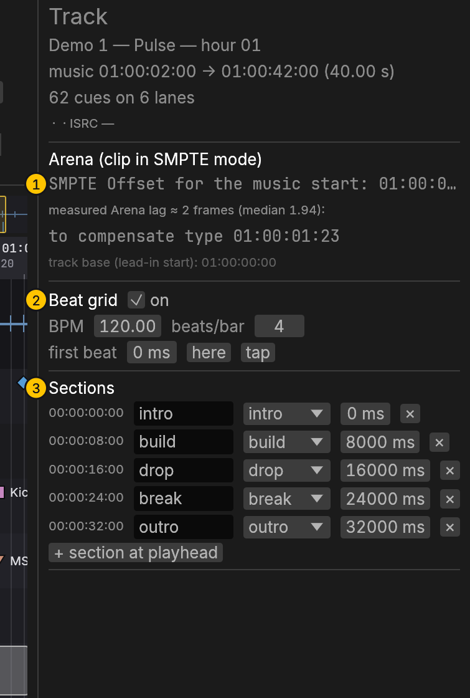

1. **SMPTE Offset for the music start**: the timecode to type into Resolume Arena when a clip runs in SMPTE mode, and
   the value that compensates Arena's measured lag of about 2 frames.
2. **Beat grid**.
3. **Sections**.

**Copy Cue Set to Track…** (in the **Cue** menu) copies the current track's cues to another track, merged or replacing,
with cues past the end cropped or clamped.

## Cues and target profiles

### Cue kinds

| Kind | What it sends | Fields |
| --- | --- | --- |
| OSC action | A typed OSC message for Resolume-style targets: `clip-connect`, `column-connect`, `layer-clear`, `group-select`, `deck-select`, `param-set`, `param-ramp`, `tempo-set`, `tempo-resync`, `crossfader-set`, `crossfader-ramp`, `custom-osc` | Layer, column, group, deck, parameter path, value, ramp from / to / duration / curve |
| Verb | A profile's named action (for example `clip_connect` with layer and clip) | The verb's typed slots; the inspector shows the address it renders to |
| Custom OSC | Any address with arguments (`i`, `f`, `s`, `b`) | **address**, arguments; addresses that trigger things (connect, select, clear) need **allow trigger addresses (explicit: connect / select / clear)**, and the inspector shows the safety gate's verdict |
| MIDI | Note (with length), CC (7-bit or **14-bit (MSB on cc, LSB on cc + 32)**), program change, CC ramp | Channel (or the lane's), note, velocity, cc, value, program, ramp curve |
| MSC | MIDI Show Control: `GO`, `STOP`, `RESUME`, `TIMED_GO`, `LOAD`, `SET`, `FIRE`, `ALL_OFF`, `RESTORE`, `RESET`, `GO_OFF` | Cue number, list, path as written; the lane sets the device id and command format |
| Marker | Nothing (a named position for jumping and looping) | Name |
| Section | Nothing (a named range: intro, build, drop, break, outro or free text) | Name, kind |

Ramps (`param-ramp`, `crossfader-ramp`, MIDI CC ramps) use the curves `hold`, `linear`, `ease-in`, `ease-out`,
`ease-in-out` and `smooth`.

### Target profiles

| Profile | Transports | Notes |
| --- | --- | --- |
| Resolume Arena (`resolume.arena-7.28`) | OSC, MIDI, REST | Measured on Arena 7.28: verbs for clips, columns, layers, groups, decks, parameters, tempo and the crossfader. |
| QLab 5 (`figure53.qlab-5`) | OSC, MIDI, MSC | Cue GO / stop and others; the pre-show check reads cue names over `/reply`. MSC with QLab's string cue numbers. |
| grandMA3 (`malighting.grandma3-2.5`) | OSC, MSC | MSC with the lighting command format, including `TIMED_GO`, `SET` and `FIRE`. |
| ChamSys MagicQ (`chamsys.magicq`) | OSC | Playback and cue verbs from ChamSys's OSC documentation. |
| Bitfocus Companion (`bitfocus.companion`) | OSC, HTTP | The fallback: drive anything Companion can control. |

The profiles are JSON files. CueDex copies them on the first launch to
`~/Library/Application Support/CueDex/profiles/`, where you can edit them.

### When a cue is sent

A cue is sent at the moment the playhead reaches it, minus the lane's lead, plus the lane's offset. CueDex never sends
an OSC cue early: it waits for the exact moment and sends then. MIDI to a named destination is handed to macOS 20 ms
ahead with the exact time stamp, so macOS delivers it on time.

## Outputs

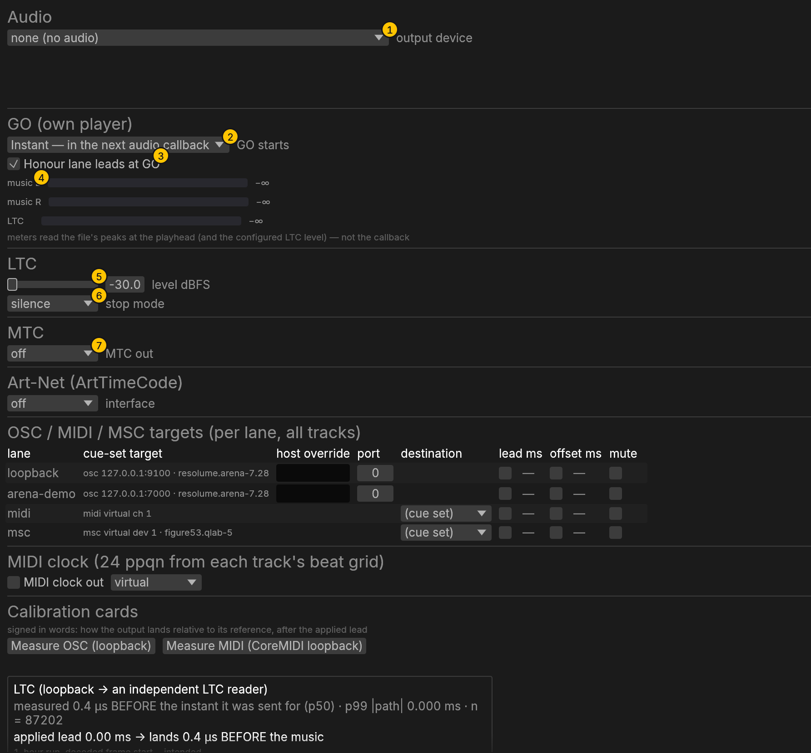

1. **output device**: **system default**, **none (no audio: model + outputs only)** (shown as **none (no audio)**), or a device (shown with its
   current rate, channels and declared latency). Below it, CueDex shows what it opened and any warnings.
2. **GO starts**: the GO mode (see [GO](#go-and-the-audio-buffer)).
3. **Honour lane leads at GO**.
4. The meters: **music L**, **music R** and **LTC**. They read the file's waveform at the playhead and the LTC level
   you set (the audio thread is never touched to measure them).
5. **level dBFS**: the LTC level, −30 to −6 dBFS (default −18; the demo set uses −30).
6. **stop mode**: what LTC does when the transport stops: **silence**, **hold** (repeat the frame), **runout:2** or
   **runout:5** (keep running 2 or 5 frames).
7. **MTC out**: **off**, the virtual source **"Cuedex MTC"**, or a MIDI destination.

### LTC

LTC is audio: route its channel to the device that carries it to your receivers. CueDex's LTC is sample-locked to the
music (measured: under 0.7 µs at the 99th percentile over 10 minutes, 0 wrong frames). When the playhead jumps, an LTC
reader relocks in one frame if the jump lands on a frame boundary; **Seek snap** makes every jump do that.

<div class="markdown-alert markdown-alert-note" markdown="1">
<p class="markdown-alert-title"><svg class="octicon octicon-info" viewBox="0 0 16 16" version="1.1" width="16" height="16" aria-hidden="true"><path d="M0 8a8 8 0 1 1 16 0A8 8 0 0 1 0 8Zm8-6.5a6.5 6.5 0 1 0 0 13 6.5 6.5 0 0 0 0-13ZM6.5 7.75A.75.75 0 0 1 7.25 7h1a.75.75 0 0 1 .75.75v2.75h.25a.75.75 0 0 1 0 1.5h-2a.75.75 0 0 1 0-1.5h.25v-2h-.25a.75.75 0 0 1-.75-.75ZM8 6a1 1 0 1 1 0-2 1 1 0 0 1 0 2Z"></path></svg>Note</p>

A cue in the first frame or two of a track cannot be chased through LTC by an external reader, because the reader
needs a frame to relock after the hour jump. CueDex's own cues (OSC, MIDI, MSC) are exact there.

</div>

### MTC, Art-Net and MIDI clock

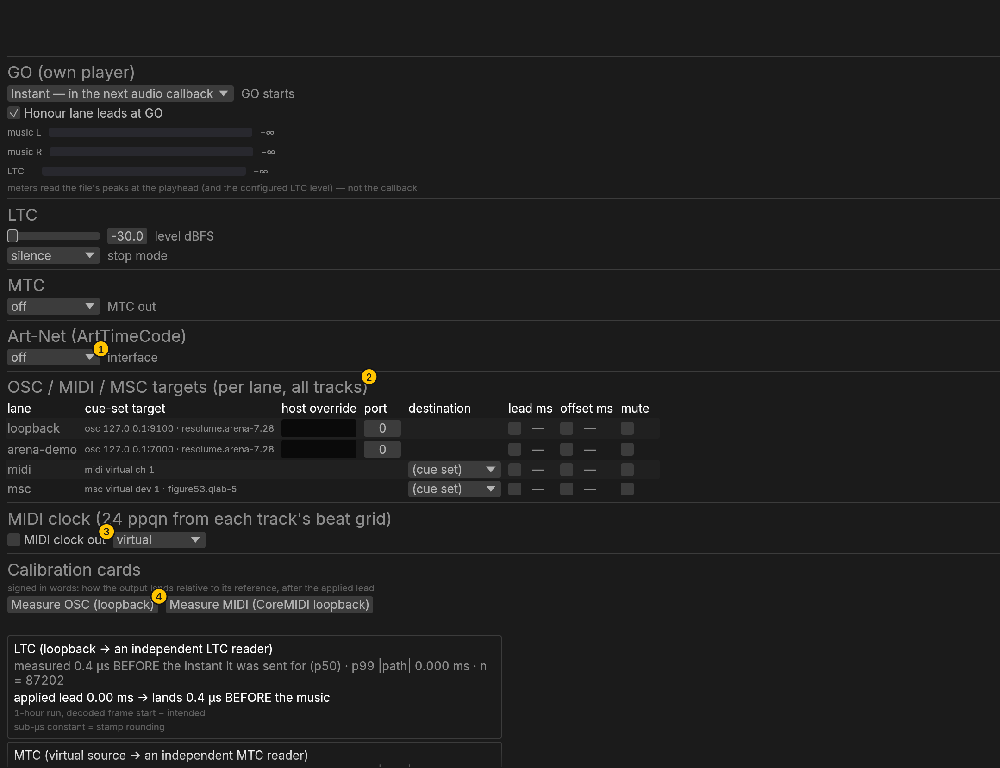

1. Art-Net: **interface** (off or a network interface), **destination** (**subnet broadcast**, **255.255.255.255** or
   an address) and **port** (default 6454, the port every Art-Net node listens on).
2. **OSC / MIDI / MSC targets (per lane, all tracks)**: override a lane's host, port, destination, lead, offset or mute
   for this set without touching the cue files.
3. **MIDI clock out**: 24 pulses per quarter note from each track's beat grid, to the virtual **CueDex MIDI** source or
   a destination. Start / stop / continue and song position follow the transport.
4. Calibration cards: **Measure OSC (loopback)** and **Measure MIDI (CoreMIDI loopback)** measure how an output lands
   compared with the instant it was meant for, and show it in words.

### OTW direct

The **OTW** tab writes CueDex's playhead into OnTheWire's transport (when OnTheWire runs on the same Mac). Tick
**OTW direct** (1): CueDex claims the transport and writes it 250 times a second. If another program takes it over,
CueDex only reads and shows **External master** with how long the other writer has been silent; **Take over** (2)
becomes available after one second of silence.

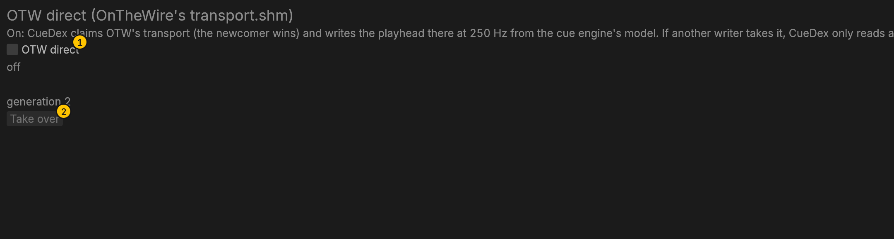

### Arena in SMPTE mode

A Resolume Arena clip can follow LTC itself (its SMPTE mode). The offset to type into the clip is in the track
inspector: see [The inspector](#the-inspector).

## GO and the audio buffer

GO (<kbd>G</kbd>, the **GO** button, the Show window or the web remote) starts the show from the playhead. With
CueDex's own player, GO from a stopped or paused transport is instant: the audio callback that takes it stamps it with
its own first sample, so music and LTC start together on that sample.

**GO starts** offers three modes:

- **Instant — in the next audio callback** (the default): the music and LTC start in the next audio buffer.
- **Readable first frame — + one LTC frame of pre-roll**: LTC starts one frame before the music, so an LTC reader
  already decodes the frame the music starts on. It costs one frame (40 ms at 25 fps).
- **Look-ahead**: the GO is stamped a fixed look-ahead ahead (the older behaviour; set the
  **command look-ahead** next to it).

**Honour lane leads at GO** (on by default; shown when **GO starts** is Instant): if a cue sits at the GO position on a lane with a lead (for example
Arena's 12 ms), CueDex delays the music and LTC by that lead so the cue still goes out on time. When there is no such
cue it costs nothing. Off: the music starts at once and that cue goes out late.

**IO buffer** sets the audio buffer for the open device (it shows while an audio device is open, not with **none**):
the default (64 frames), **device setting**, or 32 to 2048 frames. A smaller buffer means a faster GO. 64 frames is the
smallest size tested; it ran an 11-minute show test with no underruns on BlackHole and on the built-in speakers. Below the box CueDex shows what the buffer costs in milliseconds.

<div class="markdown-alert markdown-alert-tip" markdown="1">
<p class="markdown-alert-title"><svg class="octicon octicon-light-bulb" viewBox="0 0 16 16" version="1.1" width="16" height="16" aria-hidden="true"><path d="M8 1.5c-2.363 0-4 1.69-4 3.75 0 .984.424 1.625.984 2.304l.214.253c.223.264.47.556.673.848.284.411.537.896.621 1.49a.75.75 0 0 1-1.484.211c-.04-.282-.163-.547-.37-.847a8.456 8.456 0 0 0-.542-.68c-.084-.1-.173-.205-.268-.32C3.201 7.75 2.5 6.766 2.5 5.25 2.5 2.31 4.863 0 8 0s5.5 2.31 5.5 5.25c0 1.516-.701 2.5-1.328 3.259-.095.115-.184.22-.268.319-.207.245-.383.453-.541.681-.208.3-.33.565-.37.847a.751.751 0 0 1-1.485-.212c.084-.593.337-1.078.621-1.489.203-.292.45-.584.673-.848.075-.088.147-.173.213-.253.561-.679.985-1.32.985-2.304 0-2.06-1.637-3.75-4-3.75ZM5.75 12h4.5a.75.75 0 0 1 0 1.5h-4.5a.75.75 0 0 1 0-1.5ZM6 15.25a.75.75 0 0 1 .75-.75h2.5a.75.75 0 0 1 0 1.5h-2.5a.75.75 0 0 1-.75-.75Z"></path></svg>Tip</p>

Measured on an M3 (64 frames, BlackHole): from the key press to the first music sample at the output, 8.3 ms
median and 29.5 ms at the 99th percentile. Most of the worst case is macOS delivering the key press.

</div>

## Following music by ear: the listener

Use the listener when the music comes from a player CueDex does not control: a DJ set, a turntable, a band's backing
track, a stream on another computer. Set **Source** (in the Set view) to **Listener**. CueDex then recognises which
track of your set is playing and where, and steers its transport so LTC, MTC, Art-Net, cues and OTW follow what is
heard. Its own music outputs stay silent.

Every track needs a signature (the Set view's **Signatures** table): a set of landmark fingerprints and an onset
envelope, never audio. CueDex builds it from the file the first time the listener needs it, or when you click
**build**; after that it comes from the cache.

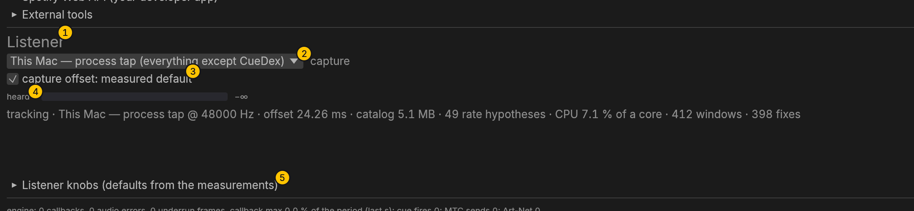

1. **Listener**: the section in **Devices**.
2. **capture**: what to listen to:
   - **This Mac — process tap (everything except CueDex)**: hears whatever the Mac plays, without rerouting anything.
   - An app (listed as *App … — process tap*): only that app's audio.
   - An input device: a line-in, an interface input, or BlackHole. Choose the **input channels (mixed to mono)**.
3. **capture offset: measured default**: CueDex compensates the capture's own delay (a process tap stamps audio about
   24 ms late; an input device 0 ms). Untick it to type your own, for example for speakers heard through a microphone.
4. **heard**: the capture level.
5. **Listener knobs (defaults from the measurements)**: every setting (the table below).

Under the meter, the status line shows the phase, the device, the rate, the offset, the size of the catalogue, the CPU
used, the windows analysed and the position fixes; below it, an error if the capture fails, the last window's evidence,
and the ShazamKit cross-check if it is on.

On the timeline, a coloured band along the waveform shows the lock state, and the waveform's header says
**Waveform — heard** with the state, the track and the confidence. The Show window shows the state in large type:

| State | Meaning |
| --- | --- |
| LISTENING | Hearing audio, not identified yet. |
| LOCKING | A match is building up (two windows must agree). |
| LOCKED | CueDex knows the track and the position and is steering the transport. |
| FREEWHEEL | The fixes have stopped (a quiet break, a scratch): the transport runs on at the last rate. |
| LOST | Digital silence or no match: after the freewheel time, the lost action runs. |

When a lock is lost, **then** decides what LTC and cues do: **stop LTC**, **keep running** or **hold the frame**.

What it handles (measured): DJ tempo changes of ±12 % (pitch follows the speed) and ±8 % with key-lock (master tempo), hot cues and loop exits
(relock in about 1.3 s typically), crossfades between two tracks of the set, stops and backspins (lost in about 0.6 s).
It never locked onto music that is not in the set in 5.8 hours of test audio.

Engine choice (**engines**): **A** is CueDex's own landmark tracker (the clock). **B** is Apple's ShazamKit with a
catalogue of your set, a cross-check only: it lags 100–250 ms and matches only within about ±5 % of the original speed.

### Listener knobs

These are the knobs under **Listener knobs**, with the defaults of this build. They are expert settings: the defaults
come from the measurements, so leave them unless you have a reason. The descriptions are the app's own tooltips (in
the app each tooltip also ends with the default).

<details markdown="1">
<summary>Every listener knob</summary>

<!-- BEGIN GENERATED: listener-knobs -->

| Knob | Default | Range | What it does |
| --- | --- | --- | --- |
| engines | A | A / B / A + B | Which recogniser follows the music. A is CueDex's own: it is exact to a few milliseconds, follows tempo changes of ±12 % and is the clock. B is Apple's ShazamKit: it only recognises music within about ±5 % of the original speed and runs 100–250 ms late, so it is only a second opinion. A + B = A follows, B checks it. |
| B while A is lost | on | on / off | With A + B: while A has lost the music, ShazamKit's positions keep the timeline going. Turn it off if you would rather have the timeline stop than run on ShazamKit's coarser positions. |
| identification window | 4 s | 2.0 … 8.0 | How much of the most recent audio is compared with the set each time. Longer recognises more reliably in noisy or effects-heavy audio; shorter reacts faster. 4 s measured best; 2 s recognised only 13 of 30 delayed test recordings. |
| step | 1 s | 0.25 … 2.0 | How often a new comparison is made. Shorter gives more position updates and uses more CPU. |
| first try after | 2 s | 1.0 … 8.0 | How much audio to hear before the first attempt to recognise the track. |
| speed range ± | 0.12 | 0.0 … 0.20 | How far from the original speed the music may be played and still be followed (0.12 = ±12 %, more than a DJ deck's ±8 %). Lower it if the music is never sped up: less CPU, and less chance of a wrong match. |
| speed step | 0.01 | 0.005 … 0.02 | The steps in which speeds inside that range are tried (0.01 = 1 %). Smaller is finer and costs more CPU. |
| key-lock search | on | on / off | Also look for music sped up without its pitch changing (a DJ's key-lock or master tempo). Turn it off if nobody uses key-lock: less CPU. |
| pitch check tolerance | 100 cents | 0.0 … 400.0 | A second, pitch-independent check confirms a match; this is how far the pitch may differ for that check to count as agreeing (100 cents = one semitone). |
| matches needed (pitch check agrees) | 6 | 3 … 40 | How many fingerprint matches recognise a track when the pitch-independent check agrees. Higher = fewer wrong recognitions but slower in difficult audio. |
| matches needed (alone) | 12 | 6 … 80 | How many fingerprint matches recognise a track without the pitch-independent check agreeing. Higher = fewer wrong recognitions but slower in difficult audio. |
| matches to keep following | 6 | 2 … 40 | How many matches keep CueDex following the position it already follows. Lower than recognising from scratch, so it holds on through a crossfade or a quiet passage. |
| pitch check matches | 3 | 1 … 20 | How many pitch-independent matches the check needs to agree (the track must also lead that check). |
| noise margin | 2× | 1.0 … 5.0 | The recognised track needs this many times the matches of the third-best track: a guard against recognising music that is not in the set (measured: no wrong recognition in 5.8 h of other music). Raise it if a track is recognised that is not playing. |
| matches spread over | 1 s | 0.0 … 4.0 | The matches must come from at least this long a stretch of the audio heard, not from one burst (a burst can be chance). |
| agreeing windows | 2 | 1 … 5 | How many comparisons in a row must agree on track and position before CueDex locks on. 1 locks faster but is easier to fool. |
| agree tolerance | 60 ms | 10.0 … 200.0 | How close two comparisons' positions must be to count as agreeing. |
| ambiguity | 0.8 | 0.3 … 1.0 | When a second place in the same track (a repeated chorus) gets at least this share of the matches (0.8 = 80 %), CueDex waits instead of locking on. 1.0 = never wait. |
| continuity | 0.5 | 0.0 … 1.0 | While following, the current position wins as long as it keeps at least this share of the matches. Identical repeats can only be told apart this way: by where the music came from. |
| recent slice | 1.5 s | 0.5 … 4.0 | The newest part of the audio that decides whether the music jumped (a hot cue or a loop shows there first). |
| speed tie | 0.9 | 0.5 … 1.0 | Speeds that score within this share of the best (0.9 = 90 %) count as a tie, and a tie keeps the current speed, so the speed does not flicker. |
| jump threshold | 250 ms | 50.0 … 2000.0 | A position this far from where the music should be is taken as a possible jump (a hot cue, a loop, a skip). |
| jump confirmations | 2 | 1 … 5 | How many comparisons must agree on the new place before the timeline jumps there. 1 jumps sooner and is easier to fool. |
| lost after | 2 s | 0.5 … 10.0 | With no recognition for this long, the listener reports the music lost, and the action under 'then' runs at once. |
| remember the place after lost | 8 s | 0.0 … 30.0 | After the music is lost, CueDex keeps looking for it anywhere in the same track for this long (a loop, a scratch, a stop), then starts a fresh search of the whole set. |
| stop: silence for | 0.5 s | 0.0 … 5.0 | Silence below the stop level for this long means the player stopped: the music is lost at once. 0 = off. |
| stop level | -120 dBFS | -140.0 … -40.0 | What counts as silence for a stop. A stopped player on an app or a virtual device sends pure digital silence; quiet breaks in music reach −70 to −80 dBFS, so keep this far below them. Raise it only for a microphone or a noisy input. |
| stop: not where the track is quiet | 0.25 | 0.0 … 1.0 | Silence where the track itself is nearly silent (under this share of its usual detail) is the music's own break, not a stop. |
| jump watch | on | on / off | While following a track, a quick extra check on that same track for a hot cue, a loop exit or a restart (measured: relocks in about 1.35 s instead of 2.8 s). |
| watch slice | 1 s | 0.5 … 2.0 | How much of the newest audio the jump watch looks at. |
| watch step | 0.25 s | 0.05 … 1.0 | How often the jump watch looks. |
| watch: min matches | 8 | 4 … 40 | Matches the new place needs before the jump watch believes it. |
| watch: over the old place | 2× | 1.0 … 5.0 | The new place needs this many times the old place's matches (and at least 4 more). |
| watch: min spread | 0.25 s | 0.0 … 1.0 | The new place's matches must come from at least this long a stretch of audio, not one burst. |
| watch: repeat ratio | 0.8 | 0.3 … 1.0 | If another place gets at least this share of the matches (a repeated bar), the jump watch cannot tell them apart and waits. |
| watch: rhythm margin | 0.1 | 0.0 … 0.5 | To jump, the loudness pattern of the music since the jump must fit the new place this much better than the old place and the repeated bar (0 = do not compare). |
| watch: rhythm fit to jump at once | 0.6 | 0.0 … 1.0 | When the loudness pattern fits the new place at least this well (1 = perfectly), one look is enough to jump. 0 = always wait for the confirmations below. |
| watch confirmations | 2 | 1 … 5 | How many looks in a row must find the new place before the jump watch jumps. |
| jump: sustained windows | 3 | 0 … 8 | This many agreeing comparisons jump even when the loudness pattern cannot tell a repeated bar apart (0 = never). |
| jump: min matches | 12 | 1 … 60 | Matches a jump found by the regular comparisons needs. |
| hold during loops | off | on / off | A DJ loop jumps back by the same length again and again: hold the position instead of jumping on every pass. |
| loop max | 8 s | 0.5 … 30.0 | The longest loop that 'hold during loops' applies to. |
| crossfade hand-over | early | early / score-cross / late | When two tracks of the set are mixed, when the timeline moves to the incoming one: early = as soon as it is recognised (its cues usually matter more); score-cross = when it is heard more clearly than the outgoing one; late = when the outgoing one is gone. |
| hand-over windows | 2 | 1 … 8 | How many comparisons in a row must agree before the hand-over. |
| hand-back hold-off | 4 s | 0.0 … 20.0 | After a hand-over, the timeline goes back to the outgoing track only if the incoming one has not been heard for this long (the fader was pulled back). |
| hand-over: repeat ratio | 0.8 | 0.3 … 1.0 | If a second place in the incoming track gets at least this share of the matches (a section repeated a few bars later), the hand-over waits — unless the chosen place continues where that track was heard before or its loudness pattern fits better. |
| hand-over: rhythm margin | 0.1 | 0.0 … 0.5 | Such an uncertain hand-over goes ahead when the chosen place's loudness pattern fits this much better than the other place's. |
| hand-over: min matches | 12 | 1 … 60 | Matches the incoming track needs for a hand-over. |
| hand-over: min score | 0 | 0.0 … 1.0 | The incoming track's matches as a share of what a clean recording of it would give, needed for a hand-over (0 = no minimum). |
| fine position | on | on / off | After a match, line the music's loudness pattern up with the track to get the position to a millisecond or two. Leave it on. |
| fine position range ± | 16 ms | 2.0 … 100.0 | How far the fine position may move from the match. Wide ranges on very regular music can land one beat subdivision off. |
| trust: match position | 5 ms | 0.5 … 50.0 | How uncertain a position from the matches alone is assumed to be. Smaller makes the timeline follow such positions more closely. |
| trust: fine position | 3 ms | 0.5 … 50.0 | How uncertain a fine position is assumed to be. Smaller makes the timeline follow it more closely. |
| pairs per landmark | 10 | 5 / 10 | How many partner points each point of the fingerprint is paired with when matching. 5 and 10 measured identical results. |
| landmarks per second | 30 | 10.0 … 80.0 | How many points of the sound are kept per second in a track's fingerprint. More can help in noisy audio and makes bigger signature files. After a change, rebuild the signatures (the rebuild buttons in the Set view). |
| landmark spacing in time | 4 | 2 … 16 | A point of the fingerprint must be the loudest within this many analysis steps (8 ms each) before and after it: smaller keeps more points close together. After a change, rebuild the signatures. |
| landmark spacing in pitch | 16 | 4 … 64 | A point of the fingerprint must be the loudest within this many frequency steps (15.6 Hz each) above and below it: smaller keeps more points close together. After a change, rebuild the signatures. |
| use 5.5–8 kHz too | on | on / off | Also take fingerprint points from the highest band (5.5–8 kHz), not only from below it. After a change, rebuild the signatures. |
| clip gate level | 0.999 | 0.5 … 1.0 | A sample at or above this level (1 = full scale) counts as clipped (distorted). |
| clip gate share | 0.05 | 0.0 … 0.5 | When more than this share of a step's samples is clipped, that step is not used: distortion makes false matches. |
| silence below | -90 dBFS | -140.0 … -20.0 | No recognition is tried on audio quieter than this. Recognition itself does not depend on the volume. |
| smoothing window | 8 s | 1.0 … 60.0 | The timeline follows a straight line through the positions of this many seconds. Longer is steadier; shorter follows speed changes sooner. |
| positions to lock | 1 | 1 … 5 | How many positions start the timeline following (the listener has already checked each one twice). |
| freewheel | 2 s | 0.0 … 30.0 | When positions stop coming (a quiet break, a scratch), the timeline runs on at the last speed for this long; then the action under 'then' runs. |
| freewheel after no position for | 3 s | 0.5 … 10.0 | How long without a new position before the timeline freewheels. A stop the listener hears (silence) acts at once; this covers everything else. |
| then | stop LTC | stop LTC / keep running / hold the frame | What timecode and cues do when the freewheel time is over. |
| correction time | 0.5 s | 0.1 … 5.0 | A small drift is removed by running the timeline slightly faster or slower for about this long, so timecode never jumps for it. |
| max correction | 0.02 | 0.0 … 0.1 | The largest speed change used for such a correction (0.02 = 2 %). |
| resync beyond | 80 ms | 10.0 … 1000.0 | When the timeline is further than this from the music, it jumps (on a frame boundary) instead of correcting slowly. |

<!-- END GENERATED: listener-knobs -->

</details>

## External players: Spotify, Music, TIDAL

An external track is played by another app. CueDex starts it there and starts its timeline on the first sound it hears
from that app, or follows when you press play in that app.

### Routes

| Route | How CueDex drives it | Notes |
| --- | --- | --- |
| **Spotify app** | AppleScript to the Spotify desktop app | Measured start error at most 1.67 ms (cold GO). |
| **Music.app** | AppleScript to Music | Measured start error at most 0.43 ms. |
| **Spotify Web (SDK)** | Spotify's Web API and a Web Playback SDK page CueDex serves at `127.0.0.1:8137` | Needs your own Spotify developer app (Client ID) and Premium. The SDK starts about 71 ms early, a constant that CueDex subtracts by default. |
| **Spotify Web → app** | The Web API commands the desktop app as a Spotify Connect device | About 24 ms early, a constant that CueDex subtracts by default. A cued GO waits on a server round trip, so it is not frame-exact. |
| **TIDAL** | Commands to the TIDAL app through macOS Now Playing (MediaRemote) | Play, pause and seek of the track TIDAL has loaded: no command can choose a track in TIDAL, so start it there once. Commands work while TIDAL is the Now Playing app. A free account plays 30-second previews. |
| **Now Playing** | Any app that publishes macOS Now Playing | Follow only: you press play in that app. |

### Adding an external track

**Add External Track (Spotify / Music / TIDAL / Now Playing)…** opens:

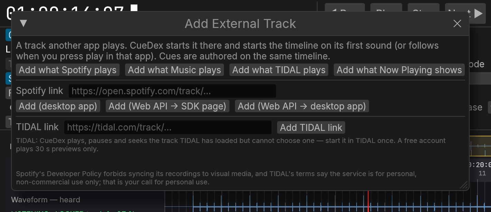

- **Add what Spotify plays**, **Add what Music plays**, **Add what Now Playing shows**: play the track in that app
  first; CueDex reads its id, title, artist and duration.
- **Add what TIDAL plays**: the same for TIDAL (title, artist and duration from macOS Now Playing; TIDAL reports no
  track id).
- A **Spotify link** with **Add (desktop app)**, **Add (Web API → SDK page)** or **Add (Web API → desktop app)**.
- A **TIDAL link** (`https://tidal.com/track/…`) with **Add TIDAL link**: CueDex reads the title, artist and length
  from TIDAL's public embed player (no login). If TIDAL is not playing that track, CueDex opens its page in TIDAL:
  play it there once, then CueDex can pause, place and start it.

#### TIDAL

1. Open TIDAL and play the track once (so TIDAL is the Now Playing app and holds the track).
2. **Add what TIDAL plays**, or paste its link and click **Add TIDAL link**.
3. Press GO in CueDex. With **pre-cue external tracks** on, CueDex places the paused track at the GO position first; the
   GO is then a resume (measured: the first sound 72 ms after the command, at the median).

On a free TIDAL account every track is a 30-second preview, and the track's length in CueDex is the preview's when
TIDAL plays it while you add it. At the end of a preview TIDAL moves on to its next track by itself. If another app
(Spotify, Music) takes over macOS Now Playing, press play in TIDAL once to bring it back.

### Starting: onset, hybrid and cued GO

The **Players (external tracks)** card in **Devices** shows each route's health and every start setting:

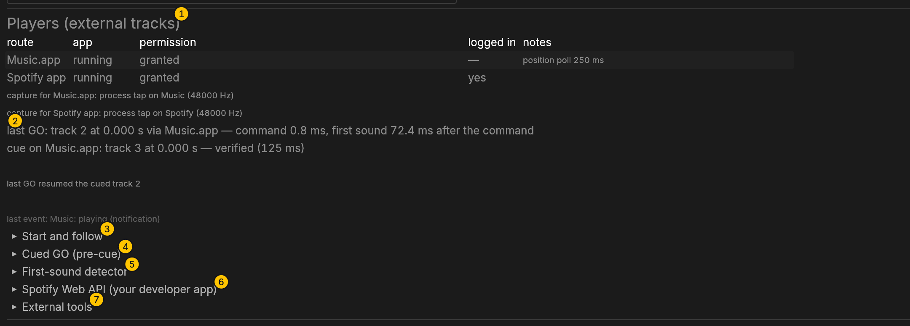

1. **Players (external tracks)**: each route with **app** (running or not), **permission**, **logged in** and notes;
   the capture per route.
2. **last GO:**: the track, the route, how long the command took and when the first sound came; below it the cue on
   each route, learning progress and the last event.
3. **Start and follow**: the start mode and the follow settings.
4. **Cued GO (pre-cue)**: load and place the track paused before the GO, so the GO is a resume.
5. **First-sound detector**: how the first sound is found.
6. **Spotify Web API (your developer app)**: the **Client ID** and the login.
7. **External tools**: `yt-dlp`, a JavaScript runtime for YouTube, `ffmpeg`, and the Now Playing adapter's self-test.

Start modes (**start on**):

- **onset**: the timeline starts on the first sound CueDex hears on the player's capture. Exact; the first output
  comes about 100 ms after the sound.
- **armed at command + route latency, snapped to the onset** (Hybrid): the timeline is armed before the command, on the
  route's measured latency, so the first output comes with the sound; then it snaps to the real onset.
- **command + mean latency**: start on the command plus the route's mean latency, and let the onset correct it.
- **notification**: the player's own "playing" message (late on Spotify).

A cued GO (**pre-cue external tracks**): CueDex loads the track in the player, places it at the GO position and pauses
it, with the volume dipped so nothing is heard, before you press GO. The GO is then a resume: the fastest and steadiest
start a player has. With the default (**Default (per route)**), Music and the Spotify app start a cued GO with Hybrid
and one LTC frame of pre-roll, and the other routes with onset.

Measured with cued GO and Hybrid, the first readable LTC frame came within one frame of the sound in 49 of 50 GOs on
Music, 47 of 50 on the Spotify app, 48 of 50 on the SDK page and 50 of 50 on TIDAL (each GO position against its own constant). The Spotify Connect route cannot
do this (0 of 50): its resume goes through Spotify's servers.

**follow the player (I press play there)**: the player's own play, seek, pause and track changes move the timeline.
**learn fingerprints on the first full play**: CueDex builds the listener's fingerprint for an external track from one
uninterrupted play (fingerprints only, no audio kept), so **listener confirms in the background** can check the
timeline afterwards.

### Spotify Web API

For the two Web routes you need your own Spotify developer app:

1. At developer.spotify.com, open *Dashboard*, create an app, and in its *Settings* add the Redirect URI
   `http://127.0.0.1:8137/spotify/callback`.
2. Copy its Client ID into **Client ID** in the **Spotify Web API (your developer app)** section.
3. Click **Log in to Spotify**. The login is kept in CueDex's folder (the refresh token only, readable by you alone).
   The Client ID is kept in your preferences, never in a set file.

<div class="markdown-alert markdown-alert-warning" markdown="1">
<p class="markdown-alert-title"><svg class="octicon octicon-alert" viewBox="0 0 16 16" version="1.1" width="16" height="16" aria-hidden="true"><path d="M6.457 1.047c.659-1.234 2.427-1.234 3.086 0l6.082 11.378A1.75 1.75 0 0 1 14.082 15H1.918a1.75 1.75 0 0 1-1.543-2.575Zm1.763.707a.25.25 0 0 0-.44 0L1.698 13.132a.25.25 0 0 0 .22.368h12.164a.25.25 0 0 0 .22-.368Zm.53 3.996v2.5a.75.75 0 0 1-1.5 0v-2.5a.75.75 0 0 1 1.5 0ZM9 11a1 1 0 1 1-2 0 1 1 0 0 1 2 0Z"></path></svg>Warning</p>

Spotify's Developer Policy forbids syncing its recordings to visual media, and TIDAL's terms say the service is for
personal, non-commercial use only. CueDex points this out in the app; how you use it is your call.

</div>

### Player knobs

<details markdown="1">
<summary>Every player and start knob</summary>

<!-- BEGIN GENERATED: player-knobs -->

| Knob | Default | Range | What it does |
| --- | --- | --- | --- |
| start on | onset | onset / armed at command + route latency, snapped to the onset / command + mean latency / notification | onset = the first sound CueDex hears on the player's capture (exact; the first output ≥ ~100 ms after the sound); hybrid = armed before the command on the route's measured latency (per GO kind: seek, load, warm, cue) so the first output comes with the sound, then snapped to the onset; command + mean latency = start before the sound and let the onset correct it; notification = the player's own claim (late on Spotify: 0.5 s+) |
| if no sound within the timeout | notification | notification / command + mean latency / wait for onset | what starts the timeline when no first sound is heard (a silent intro, a muted player) |
| timeout | 3000 ms | 200.0 … 20000.0 | how long to wait for the first sound after the command |
| capture offset | 24.26 ms | -200.0 … 200.0 | capture stamp − instant the audio leaves the output. Process tap with BlackHole output: +24.26 ms (measured); with the built-in speakers +22.60 ms. Per route as measured. |
| mean command latency (predict) | 0 ms | 0.0 … 5000.0 | for 'command + mean latency': the route's measured command → first sound mean |
| min latency | 5 ms | 0.0 … 1000.0 | a sound earlier than command + this is not the commanded one |
| correct by seek above | 80 ms | 1.0 … 1000.0 | predict mode: an onset further than this off the predicted line moves the timeline with a frame-aligned seek; smaller errors are slewed by rate (LTC never jumps) |
| follow window | 500 ms | 100.0 … 10000.0 | follow mode: how far before the player's event its sound may lie (events arrive up to ~0.3 s after the sound; longer picks up blips after a pause) |
| follow the player (I press play there) | on | on / off | the player's own play / seek / pause / track change move the timeline (notification + first sound / discontinuity) |
| learn fingerprints on the first full play | on | on / off | builds the listener's fingerprint sidecar from the capture of one uninterrupted play (fingerprints only; no audio is kept) |
| listener confirms in the background | on | on / off | with a learned fingerprint the listener checks the timeline (it never steers it) |
| position poll | 250 ms | 0.0 … 2000.0 | while playing, the player's position is read this often (0 = off): the only way to see a Spotify seek, which posts no notification |
| pre-cue external tracks | on | on / off | CueDex loads the track in its player, places it at the GO position and pauses it (volume dipped, nothing heard) BEFORE the GO; the GO is then a resume — the fastest and steadiest start a player has |
| cue the track under the playhead while stopped | on | on / off | selecting a track, seeking, or pausing on an external track cues it there |
| cue the next track this long before the current one ends | 20 s | -1.0 … 600.0 | while a track plays, the next track (if external, on another route) is cued this long before the current music ends; a player holds one track, so the next track on the SAME route is cued when the current one stops and the playhead reaches it; negative = off |
| playhead rest before a cue | 300 ms | 0.0 … 5000.0 | the playhead must rest this long before CueDex cues (a scrub does not reload the player each frame) |
| verify tolerance | 5 ms | 0.5 … 100.0 | the cue counts when the player reports that track, paused, this close to the GO position (and its capture is silent) |
| GO matches the cue within | 2 ms | 0.1 … 100.0 | a GO this close to the cued position resumes the cue; further off it is a normal (uncued) GO |
| threshold | 24 dB | 6.0 … 60.0 | a 2 ms block this far over the noise floor is sound |
| floor window | 200 ms | 20.0 … 2000.0 | silence averaged for the noise floor |
| min silence | 30 ms | 4.0 … 1000.0 | quiet needed before a start counts |
| look-back | 250 ms | 0.0 … 500.0 | how far back the start is refined (covers a player's fade-in) |
| dips | on | on / off | sound → short dip → sound (a player's gap or fade on a seek / track change) |
| splices | on | on / off | an audio → audio cut with no dip (predictor residual spike) |
| splice sensitivity | 18 dB | 6.0 … 60.0 | residual peak over its median for a splice |
| a cued GO starts on | Default (per route) | Default (per route) / onset / armed at command + route latency, snapped to the onset / command + mean latency | the start mode of a GO that resumes a cued player (the other GOs use 'start on' above). Hybrid arms the timeline on the resume + the route's measured cued latency, with one LTC frame of pre-roll, so the first readable frame comes with the sound (measured: Music 49 of 50, Spotify app 47 of 50 within a frame). Default = Hybrid on Music and the Spotify app, Onset on the others |
| refine | Crossing | Crossing / Slope / Block | crossing = first sample over the floor (after digital silence: the first non-zero sample); slope = the envelope ramp extended to the floor; block = no refinement |

Hybrid latency per route and GO kind (measured command → first sound, median; the **hybrid latency per route/kind** knobs):

| Route / GO kind | Default |
| --- | --- |
| `music/cue` | 72.4 ms |
| `music/load` | 365 ms |
| `music/seek` | 119 ms |
| `music/warm` | 409 ms |
| `spotify-app/cue` | 61.7 ms |
| `spotify-app/load` | 528 ms |
| `spotify-app/seek` | 94 ms |
| `spotify-app/warm` | 644 ms |
| `spotify-connect/cue` | 163.7 ms |
| `spotify-connect/load` | 482 ms |
| `spotify-connect/seek` | 482 ms |
| `spotify-web/cue` | 62.3 ms |
| `spotify-web/load` | 413 ms |
| `spotify-web/seek` | 413 ms |
| `tidal/cue` | 71.8 ms |
| `tidal/seek` | 77.8 ms |

<!-- END GENERATED: player-knobs -->

</details>

## Layers and shared cues

A track's cues can come from more than one place. CueDex keeps them as layers, shown in the strip above the timeline:

| Layer | What it is | Editable |
| --- | --- | --- |
| MY | Your cues. Private until you publish them. | Yes |
| SHARED | Another author's published cue set, pinned to the version you took and aligned to your copy of the music. | No |
| FORK | A published derivative of a shared set, with credit. | No |
| MERGED | The working mix: lanes and cues taken from any layer, each with its origin. | Yes |
| AUTO | Markers generated from the beat grid and sections. | Regenerate it |
| SHOW | A frozen, hash-pinned copy of MERGED for the gig. | No (freeze again) |

Click a chip to view that layer on the timeline. **M** and **S** mute and solo a layer. **Engine plays:** at the end
of the strip says which layers feed the outputs. The buttons under it:

- *Take n selected → MERGED* and **Take lane → MERGED** copy cues from the layer you view into MERGED, with their
  provenance.
- *Conflicts (n)* opens the cues of different origin that sit within one frame of each other on one lane in MERGED,
  with **keep first**, **keep second** and **keep both**.
- **AUTO ↻** regenerates AUTO (markers every 8 bars and on sections).
- **Freeze SHOW** makes the SHOW copy of MERGED.
- **Show mode** (then **SHOW MODE: on**): the engine plays every track's SHOW layer and nothing else.

<div class="markdown-alert markdown-alert-important" markdown="1">
<p class="markdown-alert-title"><svg class="octicon octicon-report" viewBox="0 0 16 16" version="1.1" width="16" height="16" aria-hidden="true"><path d="M0 1.75C0 .784.784 0 1.75 0h12.5C15.216 0 16 .784 16 1.75v9.5A1.75 1.75 0 0 1 14.25 13H8.06l-2.573 2.573A1.458 1.458 0 0 1 3 14.543V13H1.75A1.75 1.75 0 0 1 0 11.25Zm1.75-.25a.25.25 0 0 0-.25.25v9.5c0 .138.112.25.25.25h2a.75.75 0 0 1 .75.75v2.19l2.72-2.72a.749.749 0 0 1 .53-.22h6.5a.25.25 0 0 0 .25-.25v-9.5a.25.25 0 0 0-.25-.25Zm7 2.25v2.5a.75.75 0 0 1-1.5 0v-2.5a.75.75 0 0 1 1.5 0ZM9 9a1 1 0 1 1-2 0 1 1 0 0 1 2 0Z"></path></svg>Important</p>

Downloaded cues never reach a live output until you arm them. A downloaded layer shows **REHEARSE-only**; click it to
make it **ARMED** for this set. The Show window shows how many downloaded cues are held back.

</div>

### The shared database (Library → Shared)

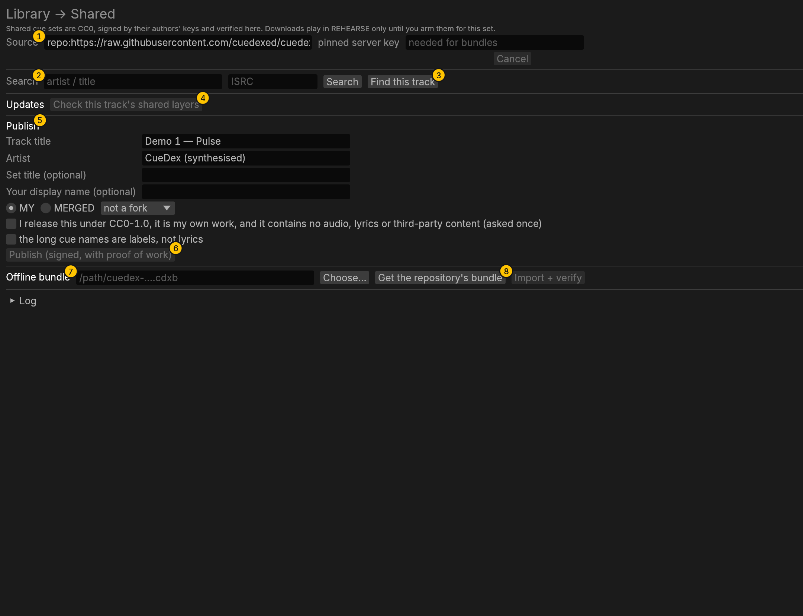

1. **Source**: where shared cues come from. The default is the public cue repository on GitHub. It can also be a
   server (`https://…`), a local clone (`repo:/path`), or an offline bundle (`bundle:/file.cdxb`, which needs the
   server's key in **pinned server key**).
2. **Search** by artist / title or ISRC.
3. **Find this track**: search by this copy's fingerprint, then by its title and artist.
4. **Check this track's shared layers**: look for newer versions of the shared sets you took. Each change is a line you
   tick to accept; unticked changes are rejected. An update never applies by itself.
5. **Publish**: the track title, artist, an optional set title and your display name.
6. **Publish (signed, with proof of work)**: publish MY or MERGED, as a new set, the next version of yours, or a
   fork of a shared set (the menu next to MY / MERGED: **not a fork** or a shared set). The first time, tick
   **I release this under CC0-1.0, it is my own work, and it contains no audio, lyrics or third-party content (asked
   once)**; the button stays disabled until you do.
7. **Offline bundle**: import a `.cdxb` bundle and verify it (**Import + verify**).
8. **Get the repository's bundle**: download the public repository's bundle for use without a network.

Each search result shows the author's name and key, the number of versions, the score and the date, with **Preview as
SHARED layer** (adds it to this track, aligned to your copy, rehearse-only), voting (**▲** / **▼**) and **Flag** with a
**flag reason**.

How it works, in short:

- *Signed.* Every published version is signed with a key made on your Mac and kept in your login keychain. The key
  is a pseudonym, not an account. Others see your display name (if you set one) and the first characters of your key.
- *Aligned.* Your copy of a track may start a little earlier or later than the author's. CueDex aligns shared cues to
  your copy by fingerprint, then refines on your own audio (measured error under 0.02 ms).
- *Proof of work.* Publishing, voting and flagging make your Mac solve a small puzzle first (a few seconds), which
  keeps spam away without accounts. The progress shows in the job row; **Cancel** stops it.
- *CC0.* Shared cue sets are released under CC0 1.0 (public domain). By publishing you confirm the set is your own
  work and contains no audio, lyrics or other third-party content. The label **the long cue names are labels, not
  lyrics** lets long cue names through the text check.

What a shared set contains, and what is never stored, is under [Privacy](#privacy). To add your sets to the public
repository, see [Sharing cues](CONTRIBUTING.md).

## The Show window and the web remote

### The Show window

**Show window** (<kbd>⌘5</kbd>) opens a second window for a second display, readable from three metres:

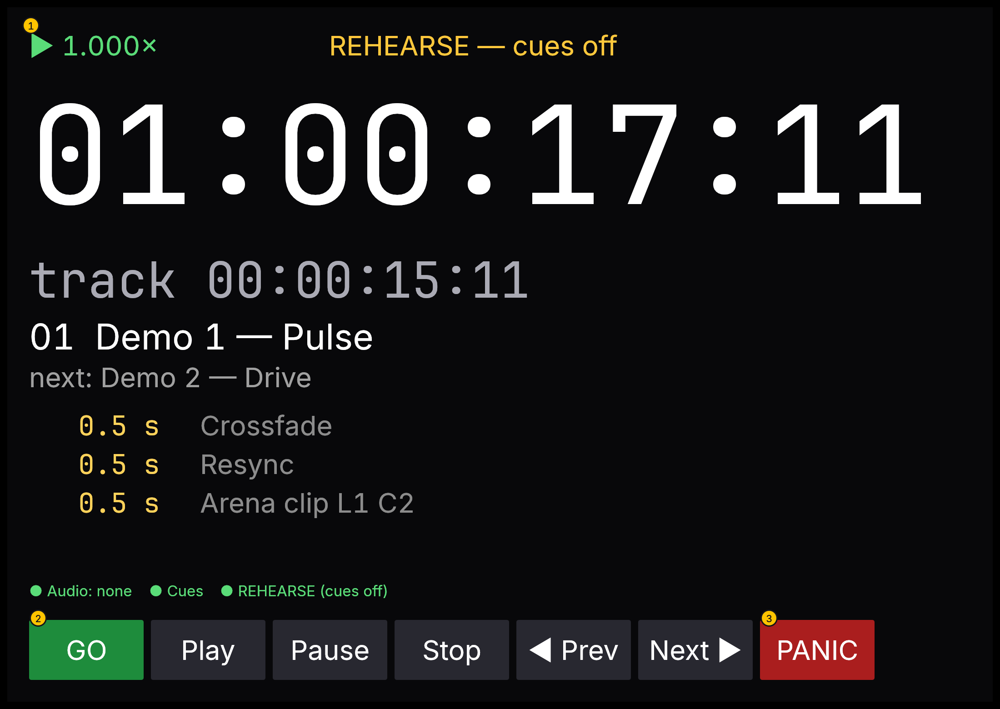

1. The transport state and rate, the **CUED** badge, and **REHEARSE — cues off** when the cues are off.
2. **GO** and the transport buttons.
3. **PANIC**.

It also shows the show timecode, the track timecode, the track and the next track, the next three cues with a
countdown, which layers play (when the set uses layers), and the health of every output (green or red; hover for
details). The sizes are in **Preferences…** under **Look**. With the listener, it shows the lock state in large type:

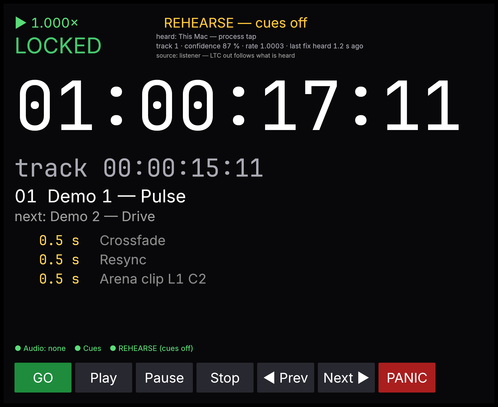

### The web remote (iPad / iPhone)

The **Web** tab serves one page to a phone or tablet on the same network:

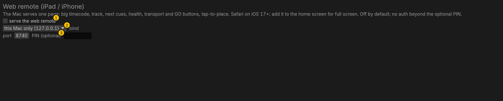

1. **serve the web remote**: on or off (off by default).
2. **bind**: **this Mac only (127.0.0.1)**, one network interface, or **all interfaces (0.0.0.0)**. Choose your Wi-Fi
   or Ethernet interface for an iPad.
3. **port** (default 8740) and **PIN (optional)**.

The tab shows the address to open (with the PIN), and how many clients are connected. On the iPad, open the address in
Safari (iOS 17 or later) and add it to the Home Screen for full screen.

| iPad | iPhone |
| --- | --- |
| 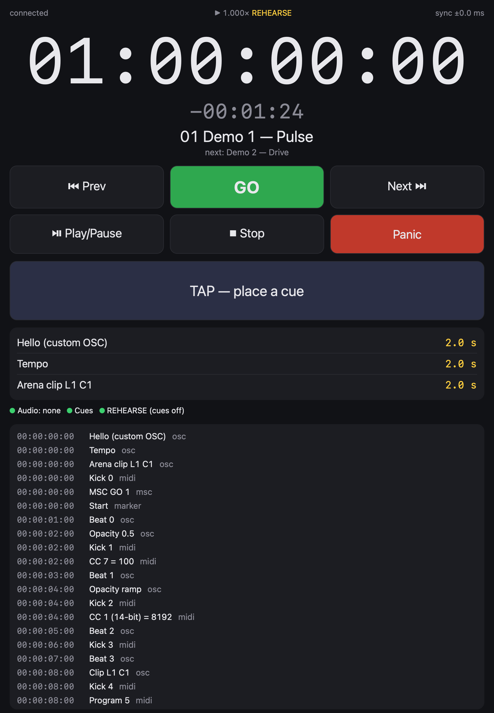 | 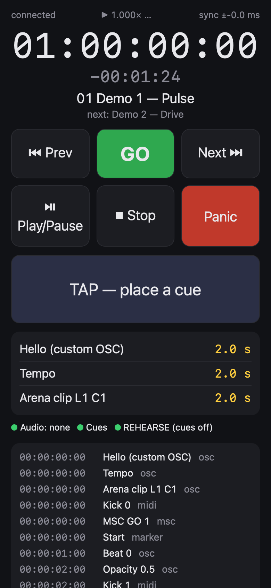 |

The page shows the timecode, the track time, the track and the next track, **⏮ Prev**, **GO**, **Next ⏭**,
**⏯ Play/Pause**, **⏹ Stop**, **Panic**, a large **TAP — place a cue** button, the next three cues, the outputs'
health and the track's cue list. It runs its own clock synchronised to the Mac (the top right shows the sync
accuracy), so the timecode on the iPad is smooth and correct. A TAP on the iPad places a cue at the moment of the touch.

<div class="markdown-alert markdown-alert-caution" markdown="1">
<p class="markdown-alert-title"><svg class="octicon octicon-stop" viewBox="0 0 16 16" version="1.1" width="16" height="16" aria-hidden="true"><path d="M4.47.22A.749.749 0 0 1 5 0h6c.199 0 .389.079.53.22l4.25 4.25c.141.14.22.331.22.53v6a.749.749 0 0 1-.22.53l-4.25 4.25A.749.749 0 0 1 11 16H5a.749.749 0 0 1-.53-.22L.22 11.53A.749.749 0 0 1 0 11V5c0-.199.079-.389.22-.53Zm.84 1.28L1.5 5.31v5.38l3.81 3.81h5.38l3.81-3.81V5.31L10.69 1.5ZM8 4a.75.75 0 0 1 .75.75v3.5a.75.75 0 0 1-1.5 0v-3.5A.75.75 0 0 1 8 4Zm0 8a1 1 0 1 1 0-2 1 1 0 0 1 0 2Z"></path></svg>Caution</p>

The web remote has no login beyond the optional PIN. Serve it on a show network you trust, not on a public Wi-Fi.

</div>

## Pre-show check

The **Pre-show** tab asks each OSC target what sits at every cue's address: Arena's name and connected state of each
clip, QLab's cue names. It never fires anything and never repairs anything.

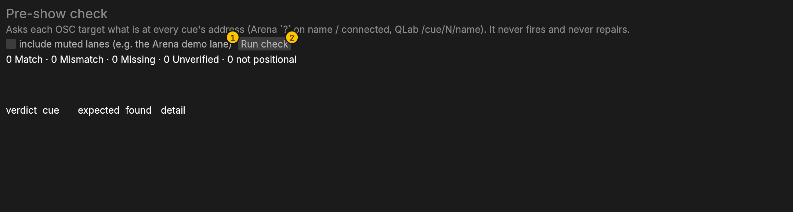

Tick **include muted lanes (e.g. the Arena demo lane)** (1) to include muted lanes, then **Run check** (2). Each cue gets
**Match**, **Mismatch** (the name differs from the cue's **expected target name**), **Missing**, **Unverified** or
not positional. **jump to cue** opens the cue on the timeline.

## The status bar and the Debug panel

The status bar at the bottom shows the frame rate, the BPM, whether snap is on and the number of cues; the last undo
step; whether edits are live; **● REC** in record mode; and the last message. **frame-time meter in the status bar**
(in the preferences) adds the time each frame of the window takes.

The **Debug** tab lists the last 500 engine events (cue fires, jumps, reloads, errors) with their time stamps.
**Copy All** (1) copies them as text, for example to attach to a bug report.

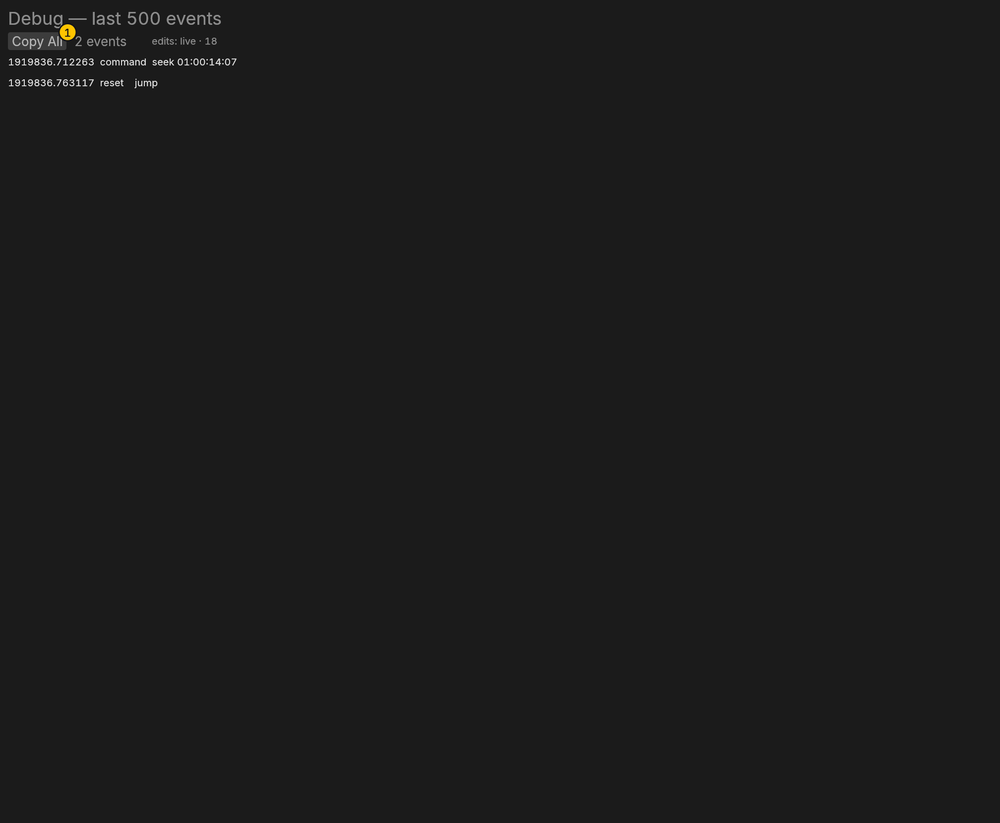

## Preferences

**Preferences…** (<kbd>⌘,</kbd>):

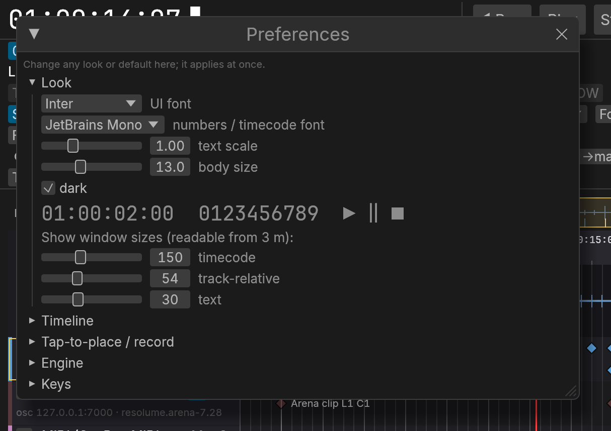

| Section | Settings |
| --- | --- |
| **Look** | **UI font** (Inter, IBM Plex Sans, Source Sans 3, Atkinson Hyperlegible), **numbers / timecode font** (JetBrains Mono, IBM Plex Mono), **text scale** (0.75–1.6), **body size**, **dark**, and the Show window's **timecode**, **track-relative** and **text** sizes. Every font has fixed-width digits, so numbers never change width. |
| **Timeline** | **snap distance (px)**, **default lane height**, **default follow**. |
| **Tap-to-place / record** | **reaction offset (ms, subtracted)**, **pre-quantise taps to the snap (the raw tap is kept)**. |
| **Engine** | **command look-ahead (ms; measured at 50; an Instant GO does not wait for it)**, **autosave every (s)**, **frame-time meter in the status bar**. |
| **Keys** | Every action with its key: **set…** records a new key (<kbd>Esc</kbd> cancels), **default** restores it. Conflicts are listed. |

Preferences live in `~/Library/Application Support/CueDex/prefs.json` on your Mac; they never go into a set file.

## Keyboard shortcuts

Every action can be rebound in **Preferences…** under **Keys**; <kbd>?</kbd> shows the current keys in the app. Keys with
<kbd>⌘</kbd> also work from the menu bar. Plain keys (without <kbd>⌘</kbd>) work whenever no text field is being
edited, even if a button has focus.

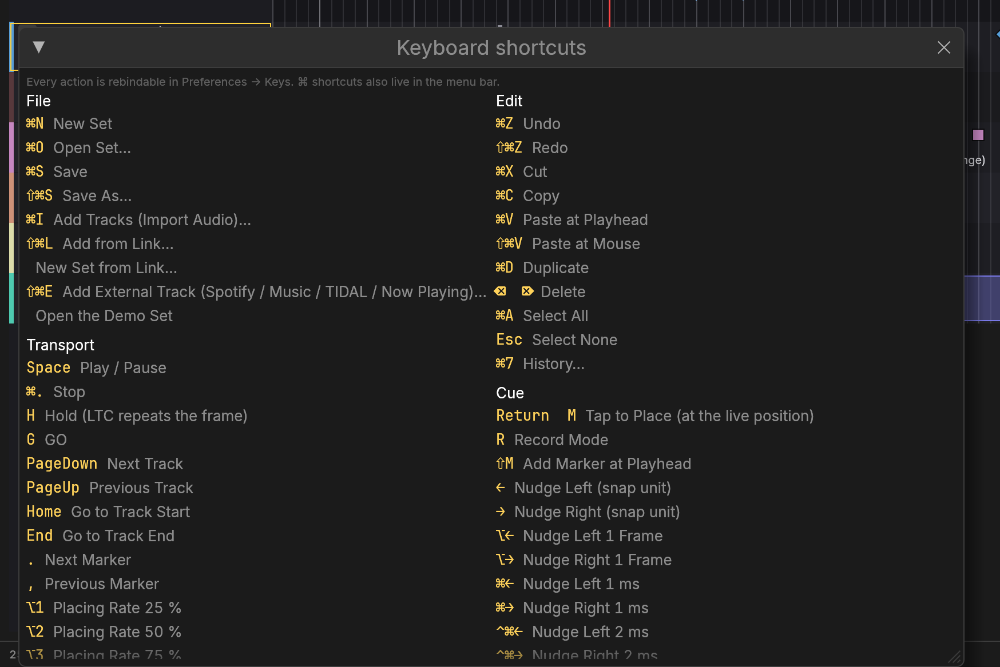

<details open markdown="1">
<summary>Every action and its default key</summary>

<!-- BEGIN GENERATED: shortcuts -->

#### CueDex menu

| Action | Default key |
| --- | --- |
| Preferences… | <kbd>⌘,</kbd> |
| About CueDex | — |

#### File menu

| Action | Default key |
| --- | --- |
| New Set | <kbd>⌘N</kbd> |
| Open Set… | <kbd>⌘O</kbd> |
| Save | <kbd>⌘S</kbd> |
| Save As… | <kbd>⇧⌘S</kbd> |
| Add Tracks (Import Audio)… | <kbd>⌘I</kbd> |
| Add from Link… | <kbd>⇧⌘L</kbd> |
| New Set from Link… | — |
| Add External Track (Spotify / Music / TIDAL / Now Playing)… | <kbd>⇧⌘E</kbd> |
| Open the Demo Set | — |

#### Edit menu

| Action | Default key |
| --- | --- |
| Undo | <kbd>⌘Z</kbd> |
| Redo | <kbd>⇧⌘Z</kbd> |
| Cut | <kbd>⌘X</kbd> |
| Copy | <kbd>⌘C</kbd> |
| Paste at Playhead | <kbd>⌘V</kbd> |
| Paste at Mouse | <kbd>⇧⌘V</kbd> |
| Duplicate | <kbd>⌘D</kbd> |
| Delete | <kbd>⌫</kbd> or <kbd>⌦</kbd> |
| Select All | <kbd>⌘A</kbd> |
| Select None | <kbd>Esc</kbd> |
| History… | <kbd>⌘7</kbd> |

#### Transport menu

| Action | Default key |
| --- | --- |
| Play / Pause | <kbd>Space</kbd> |
| Stop | <kbd>⌘.</kbd> |
| Hold (LTC repeats the frame) | <kbd>H</kbd> |
| GO | <kbd>G</kbd> |
| Next Track | <kbd>PageDown</kbd> |
| Previous Track | <kbd>PageUp</kbd> |
| Go to Track Start | <kbd>Home</kbd> |
| Go to Track End | <kbd>End</kbd> |
| Next Marker | <kbd>.</kbd> |
| Previous Marker | <kbd>,</kbd> |
| Placing Rate 25 % | <kbd>⌥1</kbd> |
| Placing Rate 50 % | <kbd>⌥2</kbd> |
| Placing Rate 75 % | <kbd>⌥3</kbd> |
| Placing Rate 100 % | <kbd>⌥4</kbd> |
| Loop On / Off | <kbd>L</kbd> |
| Loop In at Playhead | <kbd>[</kbd> |
| Loop Out at Playhead | <kbd>]</kbd> |
| Double Loop | <kbd>⌘]</kbd> |
| Halve Loop | <kbd>⌘[</kbd> |
| Nudge Loop Left | <kbd>⌥[</kbd> |
| Nudge Loop Right | <kbd>⌥]</kbd> |
| Loop to Next Marker | <kbd>⇧L</kbd> |
| Rehearse (cues off) | <kbd>⌘R</kbd> |
| PANIC: Stop, Cues Off | <kbd>⇧⌘.</kbd> |

#### Cue menu

| Action | Default key |
| --- | --- |
| Tap to Place (at the live position) | <kbd>Return</kbd> or <kbd>M</kbd> |
| Record Mode | <kbd>R</kbd> |
| Add Marker at Playhead | <kbd>⇧M</kbd> |
| Nudge Left (snap unit) | <kbd>←</kbd> |
| Nudge Right (snap unit) | <kbd>→</kbd> |
| Nudge Left 1 Frame | <kbd>⌥←</kbd> |
| Nudge Right 1 Frame | <kbd>⌥→</kbd> |
| Nudge Left 1 ms | <kbd>⌘←</kbd> |
| Nudge Right 1 ms | <kbd>⌘→</kbd> |
| Nudge Left 2 ms | <kbd>⌃⌘←</kbd> |
| Nudge Right 2 ms | <kbd>⌃⌘→</kbd> |
| Nudge Left 10 ms | <kbd>⇧⌘←</kbd> |
| Nudge Right 10 ms | <kbd>⇧⌘→</kbd> |
| Nudge Left 1 Beat | <kbd>⇧←</kbd> |
| Nudge Right 1 Beat | <kbd>⇧→</kbd> |
| Move to Lane Above | <kbd>↑</kbd> |
| Move to Lane Below | <kbd>↓</kbd> |
| Select Next Cue | <kbd>Tab</kbd> |
| Select Previous Cue | <kbd>⇧Tab</kbd> |
| Lock / Unlock | <kbd>⌘L</kbd> |
| Enable / Disable | <kbd>E</kbd> |
| Cycle State (drafted → tested → ready) | <kbd>⇧S</kbd> |
| Cycle Colour Flag | <kbd>C</kbd> |
| Quantise to Snap | <kbd>Q</kbd> |
| Back to Raw (tap) Position | <kbd>⇧Q</kbd> |
| Tap Tempo | <kbd>T</kbd> |
| Set First Beat Here | <kbd>B</kbd> |
| Copy Cue Set to Track… | — |
| Active Lane 1 (record: write a cue on lane 1) | <kbd>1</kbd> |
| Active Lane 2 (record: write a cue on lane 2) | <kbd>2</kbd> |
| Active Lane 3 (record: write a cue on lane 3) | <kbd>3</kbd> |
| Active Lane 4 (record: write a cue on lane 4) | <kbd>4</kbd> |
| Active Lane 5 (record: write a cue on lane 5) | <kbd>5</kbd> |
| Active Lane 6 (record: write a cue on lane 6) | <kbd>6</kbd> |
| Active Lane 7 (record: write a cue on lane 7) | <kbd>7</kbd> |
| Active Lane 8 (record: write a cue on lane 8) | <kbd>8</kbd> |
| Active Lane 9 (record: write a cue on lane 9) | <kbd>9</kbd> |

#### Output menu

| Action | Default key |
| --- | --- |
| Devices & Outputs | <kbd>⌘3</kbd> |
| Pre-show Check | <kbd>⌘4</kbd> |
| OTW Direct | <kbd>⌘8</kbd> |
| Web Remote (iPad / iPhone) | <kbd>⌘9</kbd> |

#### View menu

| Action | Default key |
| --- | --- |
| Snap On / Off | <kbd>S</kbd> |
| Zoom In | <kbd>+</kbd> or <kbd>=</kbd> |
| Zoom Out | <kbd>−</kbd> |
| Zoom to Fit | <kbd>0</kbd> |
| Zoom to Selection | <kbd>Z</kbd> |
| Zoom Back | <kbd>X</kbd> |
| Follow Mode (off / page / centre / edge) | <kbd>F</kbd> |
| Ruler: Timecode / Bars / mm:ss | <kbd>⇧R</kbd> |

#### Window menu

| Action | Default key |
| --- | --- |
| Set | <kbd>⌘1</kbd> |
| Timeline | <kbd>⌘2</kbd> |
| Show Window | <kbd>⌘5</kbd> |
| Debug Panel | <kbd>⌘6</kbd> |

#### Help menu

| Action | Default key |
| --- | --- |
| Keyboard Shortcuts | <kbd>?</kbd> |

<!-- END GENERATED: shortcuts -->

</details>

## Troubleshooting

| Symptom | What to check |
| --- | --- |
| No cue reaches my targets | The button says **REHEARSE: cues off**: click it or press <kbd>⌘R</kbd>. Is the lane muted (**M**) or another lane soloed? Do the host and port match? Did a **PANIC** switch the cues off? |
| My change to a lane or device did nothing | Output changes apply at the next stop; the status bar says **applies at the next stop**. Stop, then play again. |
| The LTC reader shows nothing at the start | Readers decode from the second LTC word after silence. Use **Readable first frame — + one LTC frame of pre-roll** in **GO starts**. |
| The LTC reader jumps a frame after a seek | Turn on **Seek snap** so your jumps land on frame boundaries (the reader then relocks in one frame). |
| Cues land a frame late in Arena | Set the lane's lead (Arena's measured lead is in its profile), and keep **Honour lane leads at GO** on. |
| Arena's SMPTE clip is two frames behind | Type the compensating value from the track inspector (**SMPTE Offset for the music start**). |
| "MISSING FILE" in the Set view | The file moved: **Relink…**. |
| A track will not import | Ogg / Opus are not supported yet; `.m4p` files are DRM-protected. Convert the file, or use **Add from Link…**. |
| The listener stays at LISTENING | Is the track's signature **built**? Is the capture right and is the meter moving? A process tap needs the system audio recording permission. Quiet intros take longer: CueDex needs a few seconds of music. |
| The listener is 20–50 ms off | The capture offset: through speakers and a microphone the sound arrives later; untick **capture offset: measured default** and enter the difference. |
| Spotify or Music does not start | The **permission** column says **DENIED**: allow CueDex in *System Settings → Privacy & Security → Automation*. Is the app running? |
| An external GO waits several seconds | The fallback after **timeout**: no first sound was heard (a silent intro, a muted player). Check the player's capture in the Players card. |
| The web remote does not connect | Is **serve the web remote** on and **bind** set to the network interface the iPad uses (not **this Mac only (127.0.0.1)**)? Same Wi-Fi? Allow the Local network permission. |
| The audio crackles | Raise **IO buffer** to 128 or 256 frames. Avoid heavy work on the Mac during the show. |
| A shared layer sounds off | The layer shows **⚠ unaligned**: no fingerprint match with your copy, so the offset is assumed 0. Check by ear before arming. |
| Publishing takes long | The proof of work takes a few seconds on Apple silicon; it is shown in the job row. |

## Measured performance

Numbers measured on an M3 Mac (macOS 26), with test signals recorded back through a virtual audio device, unless
noted. 1 frame = 40 ms at 25 fps. The [For developers](#for-developers) section names the report and test behind each
number.

| What | Measured |
| --- | --- |
| LTC against the music (own player, 10 min) | 99th percentile under 0.7 µs; 0 wrong LTC frames |
| LTC decoded by an independent reader (10 min) | 0 wrong frames; frame start within 0.6 µs |
| GO: key press → first music sample at the output (64-frame buffer) | 8.3 ms median, 29.5 ms 99th percentile (0.2 / 0.7 frames) |
| GO: LTC against music | 0 samples apart |
| Cues over 1 hour with every output on | 10 925 of 10 925 fired; OSC sent 2.4 µs late at the 99th percentile |
| MIDI time stamp against the cue | 0.042 µs at the 99th percentile |
| MTC | 0 wrong frames over 5 minutes at 25 and 30 fps |
| Art-Net timecode | 40.00 ms interval; jitter 0.14 ms at the 99th percentile |
| LTC relock after a jump (with **Seek snap**) | 1 frame, every time |
| Listener: time to lock | under 3.8 s |
| Listener: position error (clean audio) | 1.17 ms at the 99th percentile (transport 1.97 ms) |
| Listener: relock after a hot cue | 1.35 s median |
| Listener: false locks | 0 in 5.8 hours of music not in the set |
| Spotify app / Music: start error, cold GO | at most 1.67 ms / 0.43 ms |
| Cued GO with Hybrid: first LTC frame within one frame of the sound | Music 49/50, Spotify app 47/50, SDK 48/50, TIDAL 50/50 |
| Shared cues aligned to your copy | 0.011 ms at the 99th percentile |

## Privacy

- CueDex has no account and sends nothing to anyone unless you use a feature that does: OSC, MIDI and timecode to your
  own devices, the web remote to your own phone, the Spotify Web API when you log in, `yt-dlp` when you fetch a link,
  and the shared cue database when you search, download or publish.
- The listener and the external players analyse audio in memory. No audio is recorded or stored. Fingerprints are
  numbers that identify music and cannot be turned back into sound.
- Your preferences, Spotify Client ID and Spotify login stay on your Mac.
- What a published cue set contains: the recording's title, artist and duration (and an ISRC or platform ids if you
  add them), your optional display name, the set's title and notes, the licence, the cues (positions, lanes with a
  profile id, typed actions), your public key and signature, and the recording's fingerprint. Not stored: e-mail
  addresses, names other than the display name you choose, passwords, accounts, audio, lyrics or IP addresses. A
  server keeps a salted hash of the network address of whoever flags a set, for at most 7 days, for abuse control.
- You can delete your own published set at any time. Copies already given out under CC0 cannot be recalled.

## Licences and third-party notices

- The fonts (Inter, IBM Plex Sans and Mono, Source Sans 3, Atkinson Hyperlegible, JetBrains Mono) are under the SIL Open
  Font License 1.1; their licence texts are in **About CueDex** and in the app bundle. Inter and Atkinson Hyperlegible
  are shipped with their tabular digits as the default digits (a change the OFL allows).
- CueDex's Rust dependencies use the MIT, Apache-2.0, BSD, Zlib, ISC, BSL-1.0, CC0 and Unicode-3.0 licences; the full
  list is in **About CueDex**.
- `yt-dlp` (Unlicense) is an external program CueDex can download for you from its official release; it is never part of
  CueDex. `ffmpeg` is used only if you installed it yourself.
- Shared cue sets are CC0 1.0. This guide is published under CC BY 4.0.

## FAQ

*Does CueDex need an audio interface?* No for cues, MTC, Art-Net and OTW: choose **none (no audio: model + outputs
only)**. Yes for LTC to another device, or a virtual device for LTC to another program.

*Can I use it without the music files?* Yes: drive Spotify, Music or TIDAL, follow any Now Playing app, or follow any
player with the listener.

*Which timing is the most exact?* The own player: LTC and music come out of the same audio callback.

*Can two people share cues for the same song if their files differ?* Yes. Shared cues are aligned to your copy by
fingerprint.

*Does CueDex record or upload my audio?* No. See [Privacy](#privacy).

*How many tracks can a set have?* 24: one timecode hour each.

*What happens if I edit a cue while the show runs?* The edit is live from the playhead's next pass. Changes to outputs
wait for the next stop.

*Can I control CueDex from a lighting desk?* Not yet; CueDex sends and does not receive cues. The web remote and MIDI pads
in record mode are its remote inputs.

## Glossary

| Term | Meaning |
| --- | --- |
| LTC | Linear timecode: timecode as an audio signal. |
| MTC | MIDI timecode. |
| ArtTimeCode | Timecode over Art-Net (UDP), read by lighting consoles and media servers. |
| OSC | Open Sound Control: messages over the network. |
| MSC | MIDI Show Control: show commands (GO, STOP …) over MIDI SysEx. |
| SMPTE mode | Arena's name for a clip that follows timecode. |
| Process tap | A macOS 14.2 feature that lets an app hear what another app plays. |
| Onset | The first sound after silence. |
| Fix | One measurement of the position by the listener. |
| Freewheel | Running on at the last rate when no fixes arrive. |
| Lead | How early a lane sends so its target reacts on time. |
| Proof of work | A small calculation that makes spam expensive. |
| CC0 | Creative Commons Zero: a public-domain dedication. |

## For developers

The CueDex source is a Rust workspace. Building it, its crates and its command-line tool are described in the
repository's `README.md` and `CLAUDE.md`. In short:

```sh
export PATH="$HOME/.cargo/bin:$PATH"
cargo build --release --workspace && cargo test --release
cargo deny check
```

- The app is `crates/cuedex-app` (eframe / egui 0.36.2). Every action, menu and default key is the `actions!` table in
  `crates/cuedex-app/src/keymap.rs`; the shortcut list above is generated from it.
- Layout: every text that changes while the app runs sits in a fixed slot (`crates/cuedex-app/src/fixed.rs`); the
  test `tests/layout.rs` drives every view through running clocks, rates, seeks and counters in every font and scale
  and fails if any widget moves by more than 0.0 px.
- The guide's generated tables and its accuracy gate: `CueDex --print-reference ref.json`, then
  `python3 -I scripts/w7c/guide_ref.py write|check`.
- The screenshots: `scripts/w7c/guide_shots.sh` (offscreen renders of the real views with the demo set).

Where the measured numbers come from (the reports are in the CueDex source, `docs/`):

| Number | Report and test |
| --- | --- |
| LTC against the music: p99 0.13–0.66 µs over four file / device combinations | W1 report (`docs/W1_REPORT.md`), music + LTC lock, 600 clicks each |
| LTC decoded: 0 wrong frames, frame start p99 0.56 µs at 44.1 kHz | W0 report, LTC loopback vs the reference decoder, 10 min |
| GO key → DAC p50 8.3 / p99 29.5 ms at 64 frames; LTC − music 0.000 samples | W5e report, O1 (n = 100) |
| 10 925 / 10 925 cues in 1 h, OSC lateness p99 2.4 µs | W2 report, 1-hour run with every output |
| MIDI stamp p99 0.042 µs; MTC 0 wrong frames; Art-Net jitter p99 0.14 ms | W2 and W0 reports |
| Relock 1 frame with seek snap (20 / 20) | W2 report, FACT 4 |
| Listener lock ≤ 3.76 s; 0 fixes over 5.82 h non-catalogue audio | W4 report, L1 and S2 |
| Listener fix p99 1.17 ms, transport 1.97 ms | W5f report, L1 clean |
| Relock after a hot cue p50 1.35 s | W5b report, R1 |
| Start error Spotify app ≤ 1.67 ms, Music ≤ 0.43 ms | W5 report, P2 (n = 50 each) |
| Hybrid cued GO within one frame | W5c report, R1 (n = 50 per mode) |
| Alignment p99 0.011 ms | W7b report |
| Buffer 64 frames with 0 underruns | W5e report, buffer table |

The listener's and the external players' screenshots show states set into the views by the screenshot test; the other
screenshots are the demo set as the app shows it.
