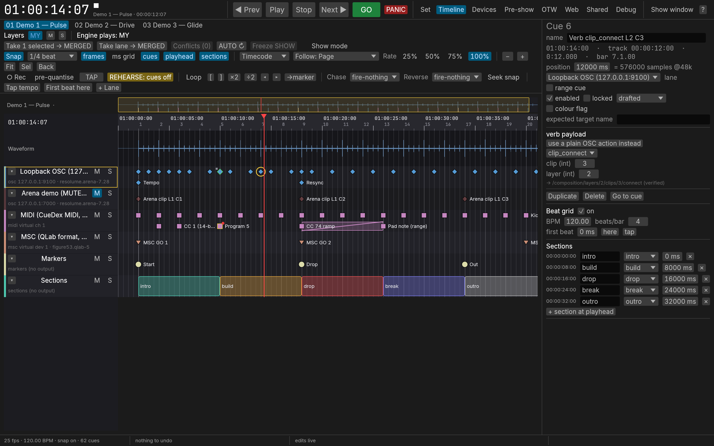

# CueDex

CueDex is a show timeline for the Mac that runs on music. You put your tracks in a set, place cues on the
music, and CueDex sends timecode (LTC, MTC, Art-Net) and cues (OSC, MIDI, MSC) at the exact moment the music gets
there. It drives Resolume Arena, QLab, grandMA3, ChamSys MagicQ, Bitfocus Companion and anything else that reads
timecode or OSC / MIDI.

## Three ways to run a show

| | How the music plays | Timing | Use it when |
| --- | --- | --- | --- |
| 1. Own player | CueDex plays your audio files (or tracks it fetched from a link) | Music and LTC come out of the same audio callback, sample-locked. GO starts in the next audio buffer. | You can bring the files. This is the most exact way. |
| 2. Drive a player | CueDex starts Spotify, Music or TIDAL for you and follows them (and follows any Now Playing app) | The timeline starts on the player's first sound. The best routes land within one frame. | The music has to come from a streaming app. |
| 3. Follow by ear | Another player plays: a DJ, a turntable, any app | CueDex listens, recognises the track and the position, and follows. Locks in about 3 s. | You don't control the player. |

## Your first show in six steps

1. Open CueDex. The first launch opens the demo set. CueDex always starts with its cues off (**REHEARSE: cues off**): timecode runs, but no cue is sent yet.
2. Build a set: choose **New Set**, then add tracks: drop audio files on the window, use **Add from Link…**, or
   add a Spotify, Music or TIDAL track with **Add External Track (Spotify / Music / TIDAL / Now Playing)…**. Each track gets its own timecode hour.
3. Choose your outputs: in **Devices**, pick the audio device and switch on MTC, Art-Net or MIDI clock if you need
   them; set the LTC channel (**LTC ch**) in the Set view.
4. Place cues: in **Timeline**, add a lane for each target, for example an OSC lane with the Resolume Arena
   profile. Then double-click to add a cue, or play the music and tap <kbd>Return</kbd> on the beat.
5. Check: run **Pre-show** to ask your targets what sits at every cue's address. Nothing fires during the
   check.
6. Go live: turn off rehearse (the button then reads **LIVE: cues on**), open the **Show window** on a second
   screen, and press <kbd>G</kbd> for GO.

## Requirements

- A Mac with Apple silicon, running macOS 14.2 or later (the listener's process tap needs 14.2).
- An audio interface or a virtual device such as BlackHole if LTC has to reach another program or another
  computer.
- Optional: Spotify, Music, TIDAL or another Now Playing app for external tracks, `yt-dlp` for links (CueDex can install it for you), and an
  iPad or iPhone for the web remote.

## Read more

- [The CueDex guide](GUIDE.md): every feature, the shortcuts, troubleshooting, measured performance, privacy and
  licences.
- [What's new](WHATS_NEW.md): the changes in each version.
- [Sharing cues](CONTRIBUTING.md): how to add your cue sets to the public cue repository.

> [!NOTE]
> CueDex is built and tested on an M3 Mac with macOS 26. Windows and Linux are planned but not built yet.
